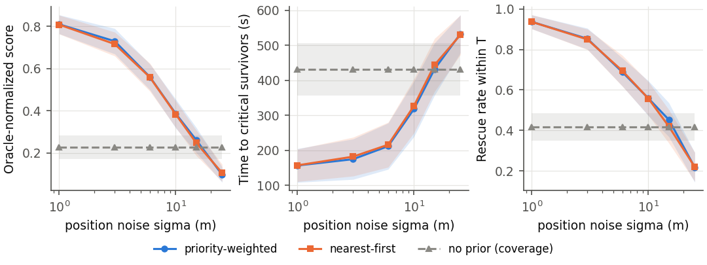
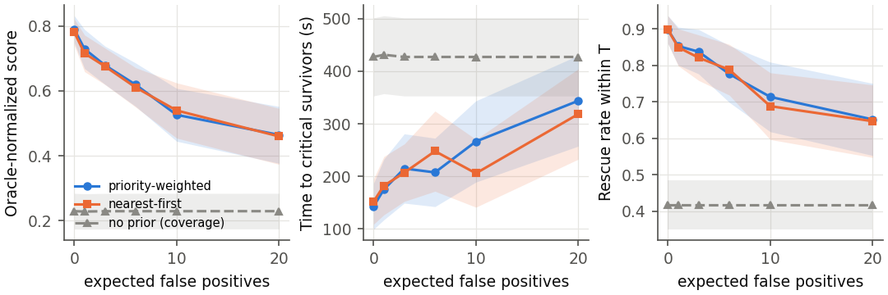
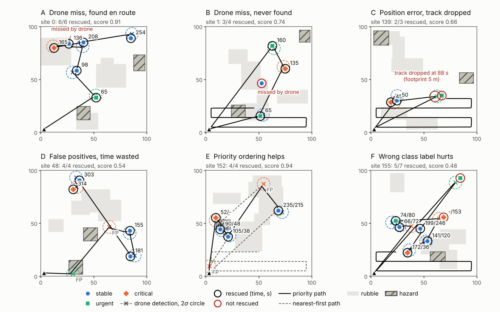
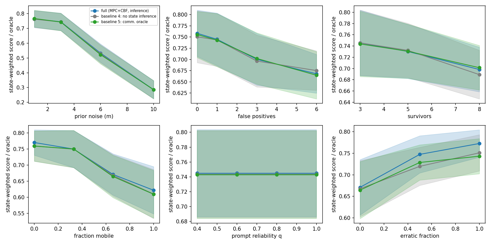

# Rubble Rescue Quadruped

Drone-informed, priority-aware search and rescue with a quadruped robot. Course project for Human-Centered Robotics (Valerie Liang, Sahil Patel).

After a collapse, a simulated quadrotor surveys the site and hands a Unitree Go2 a list of likely survivor locations, each with position uncertainty and a triage priority (critical, urgent, stable). The quadruped must decide whom to reach first, how to approach safely, and how to infer each survivor's state when they cannot answer.

## Approach

Three layers approximate the underlying POMDP:

1. **Search layer (~1 Hz):** greedy, priority-weighted, urgency-discounted search over a belief seeded by the aerial prior. Score per track is `r * w * exp(-lambda * t_arrive) / (tau + 1)^k`; `k = 1` (reward per second of travel) was best in a 60-site check (k = 0.5, 0.25, 0 were worse on score and time to critical), so it is the default (`dist_exp`).
2. **Approach planner (~10 Hz):** MPC with a unicycle model and a standoff pose as goal, plus a legibility term.
3. **Safety filter (every control step):** CBF-QP enforcing clearance from survivors and hazardous terrain.

Objective: maximize `E[ sum_i w_i * exp(-lambda_i * tau_i) * 1[tau_i <= T] ]` subject to a safety constraint, where `tau_i` is the time survivor `i` is reached.

## Research questions

|    | Question                                                                                                                                      |
| -- | --------------------------------------------------------------------------------------------------------------------------------------------- |
| Q1 | How much does the aerial prior help vs. prior-free coverage, and when does it stop helping?                                                   |
| Q2 | Does priority-weighted search reach critical survivors sooner than nearest-first?                                                             |
| Q3 | Can a CBF filter using a high-probability region of the belief eliminate violations, and what does it cost as localization uncertainty grows? |
| Q4 | How fast and accurately can survivor state (unresponsive / trapped / mobile) be inferred?                                                     |
| Q5 | Does a legibility term let an observer identify the goal earlier, and at what cost?                                                           |

Baselines: (1) coverage with no prior, (2) prior with nearest-first, (3) no safety filter, (4) no state inference, (5) communication oracle.

Metrics: priority-weighted rescue score (oracle-normalized), time to critical survivors, rescue rate within `T`, state-inference accuracy, safety violations.

## Status

Implemented (Q1-Q2):

- Drone prior: position noise, misses, false positives, class errors
- Belief with Bayes update
- Greedy search layer (priority-weighted, urgency-discounted) and baselines 1-2
- Metrics: weighted rescue score, oracle normalization, time to critical, rescue rate
- Simulators: point-robot reference (`toy_sim.py`) and reduced-order Go2 (`sim.py`), with a parallel batch runner
- Q1 sweep (prior noise, false-positive rate), Q2 comparison with a class-accuracy sweep, and plots

Q3-Q5 standalone components (unit-tested and evaluated on their own: a local unicycle integrator, synthetic tracks; the closed-loop Q3-Q5 below uses them through `StackConfig(controller="components")`):

- Clearance regions: confidence-ellipse keep-out region per belief track, with barrier `h(x)` and gradient (`rescue/clearance.py`, `PriorSearch.clearance_regions()`)
- Approach planner: sampling-based MPC (MPPI) at 10 Hz on the unicycle model with a standoff pose as goal, terrain speed caps, soft barrier costs and a one-detour router around hazards and other survivors' regions (`rescue/mpc.py`)
- Safety filter: CBF-QP over hazard rectangles and clearance discs, closed-form because the constraints are linear in forward speed only (`rescue/cbf.py`)
- Legibility: observer-model term in the MPC cost, weighted by the target's inferred mobility (`rescue/mpc.py`, `rescue/observer.py`); Q5 rollouts in `scripts/run_q5.py`
- Behaviour inference: Bayes filter over still / approaching / retreating and the induced response-state belief, with a surprise statistic for out-of-model motion (`rescue/behavior.py`); offline evaluation and baseline 4 in `scripts/run_q4.py`, on a stand-in track generator
- Safety-violation metric: trajectory steps inside a hazard region or within 1 m of a survivor (`metrics.safety_violations`, in the run CSVs); Q3 baseline 3 (no filter) in `scripts/run_q3.py`

Closed-loop Q3-Q5 (control-rate simulator, `ctrl_sim.py`; the Q1-Q2 `sim.py` is unchanged):

- `ctrl_sim.py`: 10 Hz MPC + CBF on the Go2 plant, moving survivors (still / approaching / retreating / erratic), prompts and responses, violation logging
- `stack.py`: the three layers assembled, with variants for baselines 3 (no filter), 4 (no state inference) and 5 (communication oracle)
- `ctrl_mpc.py`, `safety.py`: receding-horizon MPC with a terrain path planner, and a CBF-QP with ellipse and hazard barriers padded by a measured tracking error
- `ctrl_behavior.py`: survivor simulation and online state inference; `legibility.py`, `approach.py`: legibility term, simulated observers and the Q5 approach scenarios
- `ctrl_experiments.py` and `scripts/ctrl_run_q3.py`, `ctrl_run_q4.py`, `ctrl_run_q5.py`, `ctrl_plot.py`

## Results

Go2 sim, T = 600 s, 40 sites per config (160 for Q2). Default prior: sigma 3 m, 1 false positive, 10% miss, 80% class accuracy. Each sweep varies one setting and holds the rest at default. Figures are committed in [`figures/metrics/`](figures/metrics/). The raw per-site results (`runs/*.csv`) are git-ignored; regenerate them, and fresh figures in `runs/figures/`, with the commands under Setup.

**Metrics.** *Score* is the priority-weighted rescue score divided by the oracle's, so 1.0 is perfect. The oracle is a terrain-aware upper bound (shortest paths over rubble and hazards, standoff radius at each survivor, no robot dynamics), so scores never exceed 1 (observed maximum 0.993). *Rescue rate* is the fraction of survivors reached within T. *Time to critical* is, per site, the mean over its critical survivors of the time each is reached, counting T (600 s) for any not reached; sites with no critical survivor are excluded.

### Q1: how much does the aerial prior help?

The coverage baseline uses no prior, so it is the same in every column. It scores 0.228, reaches 42% of survivors and averages about 430 s to reach its critical survivors.

**Table 1.** Value of the aerial prior vs. position noise.

| sigma                                  | 1    | 3    | 6    | 10   | 15   | 25   |
| -------------------------------------- | ---- | ---- | ---- | ---- | ---- | ---- |
| Score, prior + priority                | 0.81 | 0.73 | 0.56 | 0.39 | 0.26 | 0.10 |
| Score, coverage                        | 0.23 | 0.23 | 0.23 | 0.23 | 0.23 | 0.23 |
| Rescue rate, prior + priority          | 0.94 | 0.85 | 0.69 | 0.56 | 0.45 | 0.22 |
| Time to critical (s), prior + priority | 157  | 175  | 212  | 318  | 432  | 533  |

*Caption: sigma is the standard deviation (m) of the Gaussian noise added to each axis of the drone's survivor position estimates; larger sigma means a less accurate prior. Score is oracle-normalized (1.0 is perfect). Each column is the mean over 40 sites, all other prior settings at default. Coverage uses no prior, so it does not depend on sigma.*



**Figure 1.** Score, time to critical and rescue rate vs. position noise sigma (log axis). Lines are means over 40 sites; bands are 95% confidence intervals. The grey dashed line and band are the no-prior coverage baseline. Priority-weighted and nearest-first overlap almost exactly, since the prior, not the ordering, drives the gap to coverage.

**Table 2.** Value of the aerial prior vs. false-positive rate.

| false positives                        | 0    | 1    | 3    | 6    | 10   | 20   |
| -------------------------------------- | ---- | ---- | ---- | ---- | ---- | ---- |
| Score, prior + priority                | 0.79 | 0.73 | 0.68 | 0.62 | 0.53 | 0.46 |
| Score, coverage                        | 0.23 | 0.23 | 0.23 | 0.23 | 0.23 | 0.23 |
| Rescue rate, prior + priority          | 0.90 | 0.85 | 0.84 | 0.78 | 0.71 | 0.65 |
| Time to critical (s), prior + priority | 143  | 175  | 215  | 208  | 266  | 344  |

*Caption: false positives is the mean of a Poisson count of spurious detections added per site, so the robot may be sent to survivors that do not exist. Mean over 40 sites per column, all other prior settings at default (sigma 3 m).*



**Figure 2.** Same three metrics vs. expected false positives per site, with the same lines, bands and baseline as Figure 1.


**Figure 3.** Prior + priority score minus no-prior coverage score over the full grid of position noise and false positives (40 sites per cell). Blue means the prior helps and red means it is worse than no prior; white is break-even. Break-even is at sigma of roughly 15-25 m and shifts toward larger sigma as false positives increase; at low noise, extra false positives cost the prior up to about 0.35 of score.

**Answer.** The prior helps a lot when it is accurate: at sigma = 3 m the score is 0.73 against 0.23 for coverage, about 3x. The gain shrinks steadily as noise grows. At sigma = 15 m the prior only matches coverage (0.26 vs 0.23, and time to critical is no better), and at 25 m it is worse than having no prior (0.10). False positives hurt much less. Even 20 spurious detections per site leave the score at 0.46, twice coverage. Position noise is what limits the prior, not clutter.

### Q2: does priority-weighted search reach critical survivors sooner than nearest-first?

Both methods use the same prior; they differ only in whether the triage class sets the target's weight. Differences are priority minus nearest, paired by site, shown as mean +/- 95% CI half-width.

**Table 3.** Priority-weighted vs. nearest-first search at the default config.

| Metric               | Nearest-first | Priority | Difference                                         |
| -------------------- | ------------- | -------- | -------------------------------------------------- |
| Score                | 0.720         | 0.733    | +0.013 +/- 0.014                                   |
| Rescue rate          | 0.854         | 0.859    | +0.005 +/- 0.009                                   |
| Time to critical (s) | 198           | 188      | -9.6 +/- 15.2 (123 sites have a critical survivor) |

*Caption: means over 160 sites. Difference is priority minus nearest-first, paired by site, with a 95% confidence half-width. For time to critical a negative difference means priority is faster, and only the 123 sites that contain a critical survivor count. No difference is significant here, because every interval includes zero.*

**Table 4.** Priority-weighted vs. nearest-first search as the drone's triage-class accuracy varies.

| Class accuracy       | 40%              | 60%              | 80% (default)    | 90%              | 100%             |
| -------------------- | ---------------- | ---------------- | ---------------- | ---------------- | ---------------- |
| Score, nearest-first | 0.709            | 0.729            | 0.720            | 0.722            | 0.713            |
| Score, priority      | 0.707            | 0.733            | 0.733            | 0.740            | 0.740            |
| Score difference     | -0.003 +/- 0.016 | +0.004 +/- 0.015 | +0.013 +/- 0.014 | +0.018 +/- 0.014 | +0.026 +/- 0.015 |

*Caption: class accuracy is the probability that the drone labels a survivor with its correct triage class (critical, urgent, stable); otherwise the label is wrong. 160 paired sites per column, all other prior settings at default. Differences are priority minus nearest-first, mean +/- 95% half-width, and are not corrected for the five comparisons. At 100% accuracy, time to critical is also 17.6 +/- 14.1 s faster with priority weighting.*


**Figure 4.** Paired priority-minus-nearest-first difference vs. drone class accuracy for score (higher is better), time to critical (lower is better) and rescue rate. Points are means over 160 sites and bars are 95% confidence intervals; an interval that excludes the zero line is a detectable difference.

**Answer.** Only partly, and only when the classes are reliable. Priority weighting does nothing at 40-80% class accuracy. Only the 90% and 100% points exclude zero, and those intervals are not corrected for the five comparisons. Even at 100% the gain is about 3 points of normalized score, so the effect is small. Most of the benefit of the pipeline comes from the prior (Q1), not from priority ordering.

The Go2 and toy simulators give near-identical numbers. Hazards are slow but traversable, and robot pose is true pose.

### Case studies: why survivors are lost

Aggregate scores do not show why a survivor is lost. Each panel of Figure 5 is one seeded Go2-sim site under the default prior (black path is prior + priority), chosen to isolate one way the prior can be wrong. The panels illustrate mechanisms and are not a sample; Table 5 gives how often each occurs.



**Figure 5.** Six rollouts. Dashed circles are 2 sigma around each drone detection, colored by reported class; markers are true survivors; black rings were rescued (labelled with the time in s), red rings were not. In E and F the labels are priority/nearest-first times ("-" = not rescued), and E also draws the nearest-first path. A-B: drone misses. C: position error. D: false positives. E-F: priority vs. nearest-first.

- **A, B: the drone misses a survivor (sites 0, 1).** The policy cannot target an unreported survivor, so it is rescued only if the 5 m onboard sensor happens to see it. In A the route to the critical survivor passes within 0.6 m of the missed one, which is rescued at 136 s. In B the three reported survivors are done by 160 s, no viable track remains, and the policy falls back to the lawnmower sweep. The sweep restarts at the waypoint nearest the start, not the robot, so it first crosses the site (about 95 m) and by 600 s has covered two rows and part of a third of eleven. The survivor lies on the sixth, and the robot passed 11.6 m from it at 114 s.
- **C: a reported position is too far off (site 139).** The drone reports the urgent survivor 4.6 m from its true position. The robot approaches the reported point and each tick without a sighting lowers the track's existence probability `r`, which falls below 0.1 at 88 s while the robot is still 6.3 m away (closest approach 5.5 m, sensor radius 5 m). The track is dropped and the survivor is never rescued, by either ordering; at sigma = 2 m the same site is 3/3.
- **D: false positives cost time, not rescues (site 48).** Two spurious detections send the planner toward nonexistent survivors early in the run. All four real survivors are still rescued, but the critical one at 314 s instead of 95 s, and the score falls from 0.91 to 0.54.
- **E, F: priority vs. nearest-first (sites 152, 155).** In E, priority rescues the critical survivor first (52 s) and all four by 235 s (score 0.94). Nearest-first clears two nearby stable survivors first, its track for the critical one falls below 0.1 while the robot is about 7 m away, and it is never rescued (0.50). In F the drone labels one critical survivor stable, so priority reaches it at 172 s instead of 36 s and scores 0.48 against 0.79; with true labels priority scores 0.80. E and F are tails: over the 160 paired sites priority scores higher on 38, lower on 32 and within 0.01 on 90, with a per-site standard deviation of 0.09 around the +0.013 mean, so wins like E and losses like F largely cancel.

**Table 5.** Why survivors are not rescued (prior + priority, 160 sites, 864 survivors, pooled).

| sigma (m)    | 1   | 3   | 6   | 10  | 15  |
| ------------ | --- | --- | --- | --- | --- |
| Unrescued    | 54  | 117 | 244 | 385 | 496 |
| Not reported | 81% | 38% | 18% | 12% | 10% |
| Dropped      | 11% | 54% | 75% | 81% | 73% |
| Other        | 7%  | 8%  | 7%  | 7%  | 17% |

*Caption: Not reported = missed by the drone. Dropped = reported, but its track fell below r = 0.1 at some point. Other = reported and never dropped (still active at T, or deleted). Reproduce with `--budget` (see Setup).*

**Takeaway.** The prior controls where the robot goes; the onboard sensor controls what it finds, and a survivor is confirmed only when the robot comes within 5 m. At sigma = 1 m misses (A, B) are 81% of the failures, which is why the rescue rate stops at 0.94 (Table 1). At the default sigma = 3 m dropped tracks (C) are the larger share (54% vs. 38%), and beyond it they dominate, one mechanism behind the loss of the prior's benefit in Q1. Three cheap remedies follow, none implemented or measured yet: (i) resume the sweep from the waypoint nearest the current position, skipping rows already covered; (ii) when no track remains, search the largest unobserved region instead of a fixed pattern; (iii) keep a track until its 2-sigma region has been searched.

## Closed-loop results: Q3-Q5

Control-rate Go2 sim, T = 600 s, 40 sites per config (100 scenarios for Q5). Figures are committed in [`figures/closed_loop/`](figures/closed_loop/); `scripts/ctrl_plot.py` regenerates them (and these tables) into `runs/figures/` from `runs/*.csv`. Differences from the Q1-Q2 simulator: sensor radius 10 m (an onboard person detector), rescue radius 3.5 m (the robot confirms from a standoff outside the 1 m clearance), and survivors can move. Q3-Q4 scores are therefore not comparable with the Q1-Q2 tables. The survivor behavior, the state-dependent reward weights (unresponsive 1.5, trapped 1.0, mobile 0.4) and the prompt-response model are modelling choices, not calibrated to people.

**Q3: safety under uncertainty.** A clearance violation is the robot centre within 1 m of any survivor (including ones already reached). Localization uncertainty is the robot's onboard measurement noise sigma_meas; the safety region is the 90% confidence ellipse of the belief.

| sigma_meas (m)                     | 0.25 | 0.5  | 1.0  | 1.5  | 2.0  |
| ---------------------------------- | ---- | ---- | ---- | ---- | ---- |
| Episodes with violation, full      | 0.00 | 0.00 | 0.00 | 0.00 | 0.00 |
| Episodes with violation, no filter | 0.57 | 0.50 | 0.38 | 0.38 | 0.33 |
| Score, full                        | 0.77 | 0.74 | 0.61 | 0.56 | 0.53 |
| Score, no filter                   | 0.79 | 0.79 | 0.64 | 0.62 | 0.57 |
| Rescue rate, full                  | 0.91 | 0.89 | 0.83 | 0.75 | 0.69 |
| Rescue rate, no filter             | 0.94 | 0.93 | 0.86 | 0.84 | 0.73 |


**Answer.** The filter removed every clearance violation in every condition. The price is 2 to 6 points of normalized score, and the loss from uncertainty itself (0.77 to 0.53) is larger than the loss from the filter. A hazard-blind planner (stress test) entered hazards in 50% of unfiltered episodes and 0% of filtered ones, at 4 points of score. With the hazard-aware planner neither variant entered a hazard, so the hazard barrier only matters when the planner fails. Raising the confidence level from 0.5 to 0.99 lowers the score from 0.78 to 0.51. The filter needs active uncertainty reduction: when the safety region is as large as the sensing range, the robot circles the region until it sees the survivor.

**Q4: survivor state.** At the default config the full system infers the state with 88% accuracy (oracle 98%) and settles on the right state about 3.2 s after the first sighting. It does not improve the rescue score: 0.745 with inference, 0.743 without, 0.743 with the oracle. At default settings the state-based weights rarely change the visiting order, so we do not claim a benefit from inference on this metric. Accuracy falls as survivors move out of model: 0.84 with no erratic survivors, 0.69 with half of the mobile survivors erratic, 0.54 with all of them, and only 35-40% on the erratic survivors themselves. Ablation curves (prior noise, false positives, survivor count, fraction mobile, prompt reliability, erratic fraction) are below.



**Q5: legibility.** On open ground with one distractor on the same side, weight lambda = 300 on a mobile survivor:

| | no legibility | lambda = 300 |
| --- | --- | --- |
| Approach time (s) | 19.5 | 25.9 (+33%) |
| Time for the cost-model observer to identify the goal (s) | 13.6 | 7.5 |
| Mean P(true goal), cost-model observer | 0.77 | 0.91 |
| Mean P(true goal), heading observer | 0.78 | 0.81 |

**Answer.** Yes for the cost-model observer, at about a third more approach time. The cost-model observer is the same family as the planner's legibility term, so that result is partly by construction; the heading observer, which does not share it, barely improves. 

Weighting by inferred state removes the cost for unresponsive survivors (19.5 s, no change) and lowers it for trapped ones, whereas a state-blind planner pays the full cost for everyone.

**Which implementation drives the closed loop.** The standalone components (`mpc.py` MPPI planner, `cbf.py` filter, `clearance.py`, `observer.py`, `behavior.py`) and the closed-loop modules (`ctrl_mpc.py`, `safety.py`, `stack.py`, `ctrl_sim.py`, `ctrl_behavior.py`) were compared by running both controllers in the same control-rate simulation (`StackConfig(controller="closed_loop" | "components")`), 30 sites, same search layer, sensors and survivors:

| sigma_meas (m) | controller | filter | score | rescue rate | episodes with clearance violation |
| --- | --- | --- | --- | --- | --- |
| 0.5 | closed-loop (`ctrl_mpc` + `safety`) | on | 0.72 | 0.88 | 0.00 |
| 0.5 | components (`mpc` + `cbf`) | on | 0.58 | 0.78 | 0.00 |
| 0.5 | closed-loop | off | 0.78 | 0.94 | 0.50 |
| 0.5 | components | off | 0.66 | 0.90 | 0.60 |
| 1.5 | closed-loop | on | 0.57 | 0.75 | 0.00 |
| 1.5 | components | on | 0.50 | 0.74 | 0.00 |
| 1.5 | closed-loop | off | 0.62 | 0.85 | 0.40 |
| 1.5 | components | off | 0.63 | 0.87 | 0.67 |

Both filters eliminate clearance violations; the closed-loop controller reaches survivors faster, so it is the default for the reported Q3-Q5 numbers. The standalone components are kept: the Bayes mode filter, terrain-aware observer and clearance regions are tested on their own (`tests/test_*`), and their controller can be switched in with `controller="components"`. It was not retuned for this simulator (its standoff is 1.2 m and it was written against a 1.5 m rescue radius), so the gap is partly tuning.

## Limitations

Survivors are a crude stand-in for people: three states, constant-speed motion, and a fixed response model. Locomotion is a reduced-order unicycle with a measured tracking-error pad, not a full-body Go2 with a learned policy, and the drone detector is parametric noise, not image-derived. The oracle for Q3-Q4 uses survivors' initial positions.

## Layout

```
rescue/
  interfaces.py    # Site, Survivor, Detection, Observation, Policy, RunLog, priority classes
  drone_prior.py   # PriorConfig, generate_detections
  belief.py        # Track, Belief (Bayes update from robot observations)
  search.py        # PriorSearch (greedy), Coverage (lawnmower)
  baselines.py     # policy factories: coverage, nearest-first, priority
  metrics.py       # rescue score, oracle, time to critical, rescue rate
  terrain.py       # terrain speed + travel-time estimate
  toy_sim.py       # point-robot reference simulator + seeded site generator
  sim.py           # reduced-order Go2 simulator (used for reported results)
  experiments.py   # parallel seeded job runner, CSV, paired statistics
  clearance.py, mpc.py, cbf.py, behavior.py, observer.py   # standalone Q3-Q5 components
  ctrl_sim.py, stack.py, ctrl_mpc.py, safety.py, ctrl_behavior.py, legibility.py,
  approach.py, ctrl_experiments.py                          # closed-loop Q3-Q5
scripts/smoke_test.py   # compare methods over N sites
scripts/run_sweeps.py   # Q1/Q2 sweeps -> runs/*.csv
scripts/plot_results.py # figures from runs/*.csv
scripts/render_site.py  # site and rollout figures
scripts/render_cases.py # six-panel case-study figure, --stats / --budget
scripts/run_q3.py, run_q4.py, run_q5.py   # standalone component evaluations
scripts/ctrl_run_q3.py, ctrl_run_q4.py, ctrl_run_q5.py, ctrl_plot.py   # closed-loop Q3-Q5
tests/
docs/INTERFACES.md
```

## Setup

```
pip install -r requirements.txt
python -m pytest
PYTHONPATH=. python scripts/smoke_test.py 20 --sim go2
RESCUE_SIM=go2 PYTHONPATH=. python scripts/run_sweeps.py 40   # -> runs/*.csv
PYTHONPATH=. python scripts/plot_results.py                    # -> runs/figures/
PYTHONPATH=. python scripts/render_cases.py --stats --budget   # -> figures/path_planning/cases_grid.png
PYTHONPATH=. python scripts/ctrl_run_q3.py 40 8    # closed-loop Q3 -> runs/q3_*.csv (last arg: workers; keep ~8 on Windows)
PYTHONPATH=. python scripts/ctrl_run_q4.py 40 8    # Q4 -> runs/q4_*.csv
PYTHONPATH=. python scripts/ctrl_run_q5.py 100 8   # Q5 -> runs/q5.csv
PYTHONPATH=. python scripts/ctrl_plot.py           # -> runs/figures/ and markdown tables
```

Requires Python 3.10+, numpy, scipy, matplotlib.
