# Rubble Rescue Quadruped

Drone-informed, priority-aware search and rescue with a quadruped robot. Course project for Human-Centered Robotics (Valerie Liang, Sahil Patel).

After a collapse, a simulated quadrotor surveys the site and hands a Unitree Go2 a list of likely survivor locations, each with position uncertainty and a triage priority (critical, urgent, stable). The quadruped must decide whom to reach first, how to approach safely, and how to infer each survivor's state when they cannot answer.

## Approach

Three layers approximate the underlying POMDP:

1. **Search layer (~1 Hz):** greedy, priority-weighted, urgency-discounted search over a belief seeded by the aerial prior. Score per track is `r * w * exp(-lambda * t_arrive) / (tau + 1)^k`; `k = 1` (reward per second of travel) was best in a 60-site check (k = 0.5, 0.25, 0 were worse on score and time to critical), so it is the default (`dist_exp`).
2. **Approach planner (~10 Hz):** MPC with a unicycle model and a standoff pose as goal, plus a legibility term.
3. **Safety filter (every control step):** CBF-QP enforcing clearance from survivors and hazardous terrain.

Objective: maximize `E[ sum_i w_i * exp(-lambda_i * tau_i) * 1[tau_i <= T] ]` subject to a safety constraint, where `tau_i` is the time survivor `i` is reached.

## Research questions

|    | Question                                                                                                                                      |
| -- | --------------------------------------------------------------------------------------------------------------------------------------------- |
| Q1 | How much does the aerial prior help vs. prior-free coverage, and when does it stop helping?                                                   |
| Q2 | Does priority-weighted search reach critical survivors sooner than nearest-first?                                                             |
| Q3 | Can a CBF filter using a high-probability region of the belief eliminate violations, and what does it cost as localization uncertainty grows? |
| Q4 | How fast and accurately can survivor state (unresponsive / trapped / mobile) be inferred?                                                     |
| Q5 | Does a legibility term let an observer identify the goal earlier, and at what cost?                                                           |

Baselines: (1) coverage with no prior, (2) prior with nearest-first, (3) no safety filter, (4) no state inference, (5) communication oracle.

Metrics: priority-weighted rescue score (oracle-normalized), time to critical survivors, rescue rate within `T`, state-inference accuracy, safety violations.

## Status

Implemented (Q1-Q2):

- Drone prior: position noise, misses, false positives, class errors
- Belief with Bayes update
- Greedy search layer (priority-weighted, urgency-discounted) and baselines 1-2
- Metrics: weighted rescue score, oracle normalization, time to critical, rescue rate
- Simulators: point-robot reference (`toy_sim.py`) and reduced-order Go2 (`sim.py`), with a parallel batch runner
- Q1 sweep (prior noise, false-positive rate), Q2 comparison with a class-accuracy sweep, and plots

Q3-Q5 standalone components (unit-tested and evaluated on their own: a local unicycle integrator, synthetic tracks; the closed-loop Q3-Q5 below uses them through `StackConfig(controller="components")`):

- Clearance regions: confidence-ellipse keep-out region per belief track, with barrier `h(x)` and gradient (`rescue/clearance.py`, `PriorSearch.clearance_regions()`)
- Approach planner: sampling-based MPC (MPPI) at 10 Hz on the unicycle model with a standoff pose as goal, terrain speed caps, soft barrier costs and a one-detour router around hazards and other survivors' regions (`rescue/mpc.py`)
- Safety filter: CBF-QP over hazard rectangles and clearance discs, closed-form because the constraints are linear in forward speed only (`rescue/cbf.py`)
- Legibility: observer-model term in the MPC cost, weighted by the target's inferred mobility (`rescue/mpc.py`, `rescue/observer.py`); Q5 rollouts in `scripts/run_q5.py`
- Behaviour inference: Bayes filter over still / approaching / retreating and the induced response-state belief, with a surprise statistic for out-of-model motion (`rescue/behavior.py`); offline evaluation and baseline 4 in `scripts/run_q4.py`, on a stand-in track generator
- Safety-violation metric: trajectory steps inside a hazard region or within 1 m of a survivor (`metrics.safety_violations`, in the run CSVs); Q3 baseline 3 (no filter) in `scripts/run_q3.py`

Closed-loop Q3-Q5 (control-rate simulator, `ctrl_sim.py`; the Q1-Q2 `sim.py` is unchanged):

- `ctrl_sim.py`: 10 Hz MPC + CBF on the Go2 plant, moving survivors (still / approaching / retreating / erratic), prompts and responses, violation logging
- `stack.py`: the three layers assembled, with variants for baselines 3 (no filter), 4 (no state inference) and 5 (communication oracle)
- `ctrl_mpc.py`, `safety.py`: receding-horizon MPC with a terrain path planner, and a CBF-QP with ellipse and hazard barriers padded by a measured tracking error
- `ctrl_behavior.py`: survivor simulation and online state inference; `legibility.py`, `approach.py`: legibility term, simulated observers and the Q5 approach scenarios
- `ctrl_experiments.py` and `scripts/ctrl_run_q3.py`, `ctrl_run_q4.py`, `ctrl_run_q5.py`, `ctrl_run_consistency.py`, `ctrl_plot.py`, `ctrl_stats.py` (paired differences with confidence intervals)
- Q4 reward models (`interfaces.RewardModel`): `base` (state rescales the reward) and `triage` (state-dependent handling time, faster decay for unresponsive survivors, self-evacuation of mobile ones), used consistently by the search layer, the simulator and the oracle; an optional drone state cue (`PriorConfig.p_state_cue`, off by default) and the `oracle_global` upper-bound variant
- Q5: a heading-legibility term in the planner (`StackConfig.legibility_heading`) and a learned third observer (`legibility.LearnedObserver`)
- Q3: safety-region confidence sweep; optional 10 Hz measurement fusion (`StackConfig.avg_meas`, off: it did not help)

Full Go2 model in MuJoCo with a learned locomotion policy (initial results, [below](#mujoco-go2-with-a-learned-locomotion-policy-initial-results); how the policies were trained and how to reproduce the simulation is in [`sim.md`](sim.md)):

- `mj_plant.py`: the Go2 robot model and learned velocity policy that `unitree_rl_mjlab` trains, rebuilt in plain MuJoCo, as an optional plant behind `ctrl_sim.py` (`run_episode_ctrl(..., plant=Go2MujocoPlant())`, or `plant="mujoco"` / `"mujoco_rubble"` in an experiment job); the unicycle stays the default
- `sim/go2/`: the flat-trained policy (`policy.onnx`) and the rough-terrain one (`policy_rough.onnx`), their training configs and the robot model
- `mj_terrain.py`: physical rubble, a heightfield built from a site's rubble and hazard regions (`Go2MujocoPlant(rubble=True)`), with the rough-terrain policy; Q3 on 100 rubble sites ([below](#physical-rubble))
- `scripts/mj_calibrate.py` (tracking and the tracking-error pad), `mj_run_q3.py`, `mj_run_conf.py`, `mj_cbf_stress.py`, `mj_rubble_calibrate.py`, `mj_run_q3_rubble.py`, `mj_run_q3_rubble_sweep.py`, `mj_run_q3_rubble_margins.py` (Q3 checks on both plants, and on a rubble heightfield at other noise levels, pads and smaller margins), `render_mj.py` (all figures in `figures/mujoco/`), `diag_stall.py` (stack-state log of episodes that stop making progress)
- Track retention (`PriorSearch(retention=...)`, off by default) and its ablation, a Q2 regime map, a sudden-threat test and a 100-site Go2 Q3 check (see [Track retention](#track-retention-fixing-the-dropped-track-loss), the regime check in Q2 and [Sudden close-range threat](#sudden-close-range-threat))
- Two stack fixes found on the Go2, on by default: the route goes around survivors' safety regions (`StackConfig.route_around_regions`), and missed detections lower a confirmed track's existence (`StackConfig.forget_stale_tracks`); see [Planner fixes](#planner-fixes-found-on-the-go2). The Q3-Q5 closed-loop tables predate them (Q1-Q2 do not use this stack)

## Results

Go2 sim, T = 600 s, 40 sites per config (160 for Q2). Default prior: sigma 3 m, 1 false positive, 10% miss, 80% class accuracy. Each sweep varies one setting and holds the rest at default. Figures are committed in [`figures/metrics/`](figures/metrics/). The raw per-site results (`runs/*.csv`) are git-ignored; regenerate them, and fresh figures in `runs/figures/`, with the commands under Setup.

**Metrics.** *Score* is the priority-weighted rescue score divided by the oracle's, so 1.0 is perfect. The oracle is a terrain-aware upper bound (shortest paths over rubble and hazards, standoff radius at each survivor, no robot dynamics), so scores never exceed 1 (observed maximum 0.993). *Rescue rate* is the fraction of survivors reached within T. *Time to critical* is, per site, the mean over its critical survivors of the time each is reached, counting T (600 s) for any not reached; sites with no critical survivor are excluded.

### Q1: how much does the aerial prior help?

The coverage baseline uses no prior, so it is the same in every column. It scores 0.228, reaches 42% of survivors and averages about 430 s to reach its critical survivors.

**Table 1.** Value of the aerial prior vs. position noise.

| sigma                                  | 1    | 3    | 6    | 10   | 15   | 25   |
| -------------------------------------- | ---- | ---- | ---- | ---- | ---- | ---- |
| Score, prior + priority                | 0.81 | 0.73 | 0.56 | 0.39 | 0.26 | 0.10 |
| Score, coverage                        | 0.23 | 0.23 | 0.23 | 0.23 | 0.23 | 0.23 |
| Rescue rate, prior + priority          | 0.94 | 0.85 | 0.69 | 0.56 | 0.45 | 0.22 |
| Time to critical (s), prior + priority | 157  | 175  | 212  | 318  | 432  | 533  |

*Caption: sigma is the standard deviation (m) of the Gaussian noise added to each axis of the drone's survivor position estimates; larger sigma means a less accurate prior. Score is oracle-normalized (1.0 is perfect). Each column is the mean over 40 sites, all other prior settings at default. Coverage uses no prior, so it does not depend on sigma.*


**Figure 1.** Score, time to critical and rescue rate vs. position noise sigma (log axis). Lines are means over 40 sites; bands are 95% confidence intervals. The grey dashed line and band are the no-prior coverage baseline. Priority-weighted and nearest-first overlap almost exactly, since the prior, not the ordering, drives the gap to coverage.

**Table 2.** Value of the aerial prior vs. false-positive rate.

| false positives                        | 0    | 1    | 3    | 6    | 10   | 20   |
| -------------------------------------- | ---- | ---- | ---- | ---- | ---- | ---- |
| Score, prior + priority                | 0.79 | 0.73 | 0.68 | 0.62 | 0.53 | 0.46 |
| Score, coverage                        | 0.23 | 0.23 | 0.23 | 0.23 | 0.23 | 0.23 |
| Rescue rate, prior + priority          | 0.90 | 0.85 | 0.84 | 0.78 | 0.71 | 0.65 |
| Time to critical (s), prior + priority | 143  | 175  | 215  | 208  | 266  | 344  |

*Caption: false positives is the mean of a Poisson count of spurious detections added per site, so the robot may be sent to survivors that do not exist. Mean over 40 sites per column, all other prior settings at default (sigma 3 m).*


**Figure 2.** Same three metrics vs. expected false positives per site, with the same lines, bands and baseline as Figure 1.


**Figure 3.** Prior + priority score minus no-prior coverage score over the full grid of position noise and false positives (40 sites per cell). Blue means the prior helps and red means it is worse than no prior; white is break-even. Break-even is at sigma of roughly 15-25 m and shifts toward larger sigma as false positives increase; at low noise, extra false positives cost the prior up to about 0.35 of score.

**Answer.** The prior helps a lot when it is accurate: at sigma = 3 m the score is 0.73 against 0.23 for coverage, about 3x. The gain shrinks steadily as noise grows. At sigma = 15 m the prior only matches coverage (0.26 vs 0.23, and time to critical is no better), and at 25 m it is worse than having no prior (0.10). False positives hurt much less. Even 20 spurious detections per site leave the score at 0.46, twice coverage. Position noise is what limits the prior, not clutter.

### Q2: does priority-weighted search reach critical survivors sooner than nearest-first?

Both methods use the same prior; they differ only in whether the triage class sets the target's weight. Differences are priority minus nearest, paired by site, shown as mean +/- 95% CI half-width.

**Table 3.** Priority-weighted vs. nearest-first search at the default config.

| Metric               | Nearest-first | Priority | Difference                                         |
| -------------------- | ------------- | -------- | -------------------------------------------------- |
| Score                | 0.720         | 0.733    | +0.013 +/- 0.014                                   |
| Rescue rate          | 0.854         | 0.859    | +0.005 +/- 0.009                                   |
| Time to critical (s) | 198           | 188      | -9.6 +/- 15.2 (123 sites have a critical survivor) |

*Caption: means over 160 sites. Difference is priority minus nearest-first, paired by site, with a 95% confidence half-width. For time to critical a negative difference means priority is faster, and only the 123 sites that contain a critical survivor count. No difference is significant here, because every interval includes zero.*

**Table 4.** Priority-weighted vs. nearest-first search as the drone's triage-class accuracy varies.

| Class accuracy       | 40%              | 60%              | 80% (default)    | 90%              | 100%             |
| -------------------- | ---------------- | ---------------- | ---------------- | ---------------- | ---------------- |
| Score, nearest-first | 0.709            | 0.729            | 0.720            | 0.722            | 0.713            |
| Score, priority      | 0.707            | 0.733            | 0.733            | 0.740            | 0.740            |
| Score difference     | -0.003 +/- 0.016 | +0.004 +/- 0.015 | +0.013 +/- 0.014 | +0.018 +/- 0.014 | +0.026 +/- 0.015 |

*Caption: class accuracy is the probability that the drone labels a survivor with its correct triage class (critical, urgent, stable); otherwise the label is wrong. 160 paired sites per column, all other prior settings at default. Differences are priority minus nearest-first, mean +/- 95% half-width, and are not corrected for the five comparisons. At 100% accuracy, time to critical is also 17.6 +/- 14.1 s faster with priority weighting.*

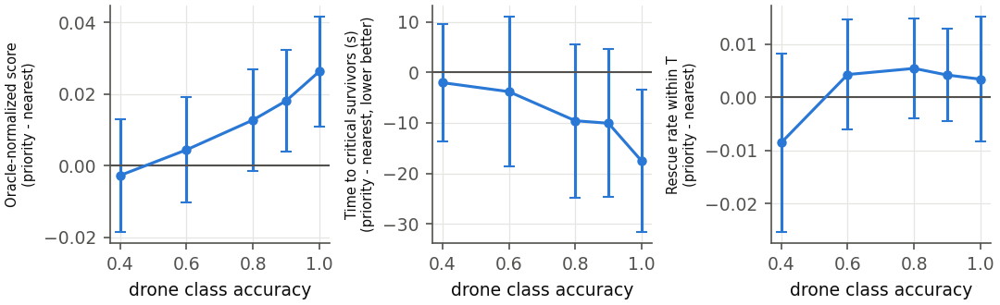

**Figure 4.** Paired priority-minus-nearest-first difference vs. drone class accuracy for score (higher is better), time to critical (lower is better) and rescue rate. Points are means over 160 sites and bars are 95% confidence intervals; an interval that excludes the zero line is a detectable difference.

**Answer.** Only partly, and only when the classes are reliable. Priority weighting does nothing at 40-80% class accuracy. Only the 90% and 100% points exclude zero, and those intervals are not corrected for the five comparisons. Even at 100% the gain is about 3 points of normalized score, so the effect is small. Most of the benefit of the pipeline comes from the prior (Q1), not from priority ordering.

**Regime check: is ordering only useful when the robot is time-limited?** One explanation for the null is that T = 600 s rarely binds, so ordering has little to trade off. We tested it (`scripts/run_regime.py`, 160 sites per cell): priority vs. nearest-first over T = 100, 150, 300, 600 s and 3, 5, 8 survivors per site, at the default 80% class accuracy and at 100%. At 80% every score difference is within +/-0.025 of zero and no cell excludes it (for example 8 survivors, T = 100 s: -0.007 +/- 0.027). At 100% the point estimates are small (-0.011 to +0.023); two of the twelve cells exclude zero (5 survivors at T = 300 s, +0.022 +/- 0.019, and at T = 600 s, +0.023 +/- 0.018), uncorrected for the twelve comparisons and not in the short-T cells where ordering should matter most. Nearest-first itself falls from 0.70 to 0.47-0.58 as T shrinks, so the robot is capacity-limited in the short-T cells, and ordering still does not help. **So "T rarely binds" is not the reason.** The reason is in the reward itself (next paragraph). Time to critical at 100% accuracy is a few seconds faster with priority (for example -6.4 +/- 8.3 s at 8 survivors, T = 300 s). Results are in `runs/regime_q2.csv`.

**Why ordering is null: the decay cancels the class weights.** The reward for reaching a survivor at time t is `w * exp(-decay * t)` with weights 1/2/4 and decays 0.002/0.005/0.01 per s (stable/urgent/critical; modelling choices, not calibrated). A critical survivor is worth 4x a stable one at t = 0, 2.5x at 60 s, 1.5x at 120 s, and **less than a stable one after 173 s** (an urgent one after 231 s); the mean rescue time is about 190 s. So by the time the robot arrives, class says little about what a rescue is worth, and there is little for ordering to gain. We tested this by changing the reward shape (`scripts/run_reward_shape.py`; 8 survivors, T = 300 s, 160 sites, then 160 fresh sites; each setting scored against its own oracle; priority minus nearest-first, score):

**Table 4b.** Priority minus nearest-first by reward shape (`*` = interval excludes zero; 16 settings, uncorrected).

| Reward | 80% labels | 100% labels | 100% labels, fresh sites |
| --- | --- | --- | --- |
| Default (weights 1/2/4, decay x1) | -0.001 +/- 0.017 | +0.008 +/- 0.019 | +0.013 +/- 0.015 |
| No decay | -0.026 +/- 0.024* | -0.015 +/- 0.024 | -0.009 +/- 0.023 |
| Decay x0.3 | -0.010 +/- 0.022 | +0.006 +/- 0.022 | +0.015 +/- 0.018 |
| Decay x3 | -0.008 +/- 0.014 | -0.003 +/- 0.015 | +0.002 +/- 0.013 |
| Decay x10 | +0.006 +/- 0.030 | +0.044 +/- 0.024* | +0.039 +/- 0.023* |
| Weights 1/4/16, decay x1 | +0.012 +/- 0.029 | +0.051 +/- 0.025* | +0.049 +/- 0.023* |
| Weights 1/4/16, decay x3 | +0.001 +/- 0.023 | +0.018 +/- 0.021 | +0.024 +/- 0.022* |
| Class irrelevant (weights 1/1/1, no decay) | -0.011 +/- 0.006* | +0.002 +/- 0.012 | -0.002 +/- 0.006 |

- **Making survivors die faster does not fix it, and it hurts time to critical.** With decay x10 the score gain is +0.04 at 100% labels, but priority reaches critical survivors **about 77 s later** than nearest-first (+77 +/- 13 s; +87 +/- 12 s on fresh sites). The search score is time-discounted, so when critical survivors decay quickly the planner writes them off and goes to stable ones, which is the opposite of triage.
- **What helps is weights that outlast the decay.** With weights 1/4/16 and the default decay, priority gains +0.05 (+0.051 +/- 0.025, fresh +0.049 +/- 0.023) and reaches critical survivors 26 s sooner (-26 +/- 10 s), the clearest case for priority ordering we found.
- **It still needs accurate labels.** At 80% labels none of the settings is positive and detectable, including the 1/4/16 weights (+0.012 +/- 0.029). This matches Table 4.
- **Reading it:** this is a sensitivity analysis of an assumed reward, not evidence about real triage. It says priority ordering pays only if the class weight is large enough to survive the time decay and the drone's labels are about 90%+ accurate; with the default reward it does neither. Only two of the eight settings are detectable at 100% labels on both site sets, and with 16 settings some stars are expected by chance, so treat the pattern, not any single cell, as the finding.

**What if the class weights are made bigger?** `scripts/run_reward_weights.py` raises the stable/urgent/critical weights from 1/2/4 to 1/4/16, 1/8/64 and 1/16/256 (default decay), in the default scene (3-8 survivors, T = 600 s) and in a capacity-limited one (8 survivors, T = 300 s), at 80, 90 and 100% class accuracy, 160 sites per cell.

**Table 4c.** Priority minus nearest-first, score (time to critical in s in brackets), default scene; `*` = interval excludes zero (uncorrected; 12 cells).

| Weights | 80% labels | 90% labels | 100% labels |
| --- | --- | --- | --- |
| 1/2/4 (default) | +0.013 +/- 0.014 (-10 +/- 15) | +0.018 +/- 0.014* (-10 +/- 15) | +0.026 +/- 0.015* (-18 +/- 14*) |
| 1/4/16 | +0.009 +/- 0.028 (-12 +/- 22) | +0.034 +/- 0.026* (-25 +/- 19*) | +0.057 +/- 0.025* (-32 +/- 20*) |
| 1/8/64 | +0.011 +/- 0.036 (-9 +/- 23) | +0.046 +/- 0.034* (-29 +/- 21*) | +0.091 +/- 0.033* (-39 +/- 23*) |
| 1/16/256 | +0.012 +/- 0.042 (0 +/- 24) | +0.052 +/- 0.041* (-21 +/- 23) | +0.105 +/- 0.039* (-35 +/- 24*) |

- **The gain scales with the weight and with label accuracy.** At 100% labels it grows from +0.026 to +0.105; at 90% from +0.018 to +0.052; at 80% it stays null at every weight (about +0.01, intervals of +/-0.03-0.04). Bigger weights amplify the drone's label errors as much as its correct labels, so at 80% they cancel (case F in Figure 5 is the same failure). In the capacity-limited scene the pattern is the same and slightly larger (+0.116 +/- 0.036 at 1/16/256 and 100% labels).
- **Critical survivors are reached 30-40 s sooner** at 100% labels once the weights exceed the decay (1/4/16 and above), in both scenes.
- **Nearest-first falls from 0.72 to 0.59** as the weights grow, because the score is normalized by an oracle that now cares mostly about critical survivors, which nearest-first ignores; priority ordering is the only method that follows the reward.
- **Retention is independent of the weights.** The `keep` gain over plain priority is +0.03 to +0.05 in the default scene at every weight and accuracy (Table 5c's effect), so the two results are separate.
- **Reading it:** if triage class really is worth several times more than the time decay erodes, priority ordering earns 5-10 points of score at 90-100% labels. Whether real triage reward is shaped like that is not something this simulator can tell us.

The Go2 and toy simulators give near-identical numbers. Hazards are slow but traversable, and robot pose is true pose.

### Case studies: why survivors are lost

Aggregate scores do not show why a survivor is lost. Each panel of Figure 5 is one seeded Go2-sim site under the default prior (black path is prior + priority), chosen to isolate one way the prior can be wrong. The panels illustrate mechanisms and are not a sample; Table 5 gives how often each occurs.


**Figure 5.** Six rollouts. Dashed circles are 2 sigma around each drone detection, colored by reported class; markers are true survivors; black rings were rescued (labelled with the time in s), red rings were not. In E and F the labels are priority/nearest-first times ("-" = not rescued), and E also draws the nearest-first path. A-B: drone misses. C: position error. D: false positives. E-F: priority vs. nearest-first.

- **A, B: the drone misses a survivor (sites 0, 1).** The policy cannot target an unreported survivor, so it is rescued only if the 5 m onboard sensor happens to see it. In A the route to the critical survivor passes within 0.6 m of the missed one, which is rescued at 136 s. In B the three reported survivors are done by 160 s, no viable track remains, and the policy falls back to the lawnmower sweep. The sweep restarts at the waypoint nearest the start, not the robot, so it first crosses the site (about 95 m) and by 600 s has covered two rows and part of a third of eleven. The survivor lies on the sixth, and the robot passed 11.6 m from it at 114 s.
- **C: a reported position is too far off (site 139).** The drone reports the urgent survivor 4.6 m from its true position. The robot approaches the reported point and each tick without a sighting lowers the track's existence probability `r`, which falls below 0.1 at 88 s while the robot is still 6.3 m away (closest approach 5.5 m, sensor radius 5 m). The track is dropped and the survivor is never rescued, by either ordering; at sigma = 2 m the same site is 3/3.
- **D: false positives cost time, not rescues (site 48).** Two spurious detections send the planner toward nonexistent survivors early in the run. All four real survivors are still rescued, but the critical one at 314 s instead of 95 s, and the score falls from 0.91 to 0.54.
- **E, F: priority vs. nearest-first (sites 152, 155).** In E, priority rescues the critical survivor first (52 s) and all four by 235 s (score 0.94). Nearest-first clears two nearby stable survivors first, its track for the critical one falls below 0.1 while the robot is about 7 m away, and it is never rescued (0.50). In F the drone labels one critical survivor stable, so priority reaches it at 172 s instead of 36 s and scores 0.48 against 0.79; with true labels priority scores 0.80. E and F are tails: over the 160 paired sites priority scores higher on 38, lower on 32 and within 0.01 on 90, with a per-site standard deviation of 0.09 around the +0.013 mean, so wins like E and losses like F largely cancel.

**Table 5.** Why survivors are not rescued (prior + priority, 160 sites, 864 survivors, pooled).

| sigma (m)    | 1   | 3   | 6   | 10  | 15  |
| ------------ | --- | --- | --- | --- | --- |
| Unrescued    | 54  | 117 | 244 | 385 | 496 |
| Not reported | 81% | 38% | 18% | 12% | 10% |
| Dropped      | 11% | 54% | 75% | 81% | 73% |
| Other        | 7%  | 8%  | 7%  | 7%  | 17% |

*Caption: Not reported = missed by the drone. Dropped = reported, but its track fell below r = 0.1 at some point. Other = reported and never dropped (still active at T, or deleted). Reproduce with `--budget` (see Setup).*

**Takeaway.** The prior controls where the robot goes; the onboard sensor controls what it finds, and a survivor is confirmed only when the robot comes within 5 m. At sigma = 1 m misses (A, B) are 81% of the failures, which is why the rescue rate stops at 0.94 (Table 1). At the default sigma = 3 m dropped tracks (C) are the larger share (54% vs. 38%), and beyond it they dominate, one mechanism behind the loss of the prior's benefit in Q1. Three cheap remedies follow, implemented and measured in [Track retention](#track-retention-fixing-the-dropped-track-loss) below: (i) resume the sweep from the waypoint nearest the current position, skipping rows already covered; (ii) when no track remains, search the largest unobserved region instead of a fixed pattern; (iii) keep a track until its 2-sigma region has been searched. Only (iii) helps.

### Track retention: fixing the dropped-track loss

`PriorSearch(retention=...)` (off by default, so every table above is unchanged). Variants are named for the remedy: `resume` (i), `region` (ii), `keep` (iii; the track's existence probability is held at the viability threshold until 90% of its 2-sigma disc has been under the sensor, and the robot searches the nearest unobserved point of that disc rather than only the mean). `scripts/run_retention.py` runs each on the same 160 sites and drone detections as the priority baseline; `scripts/run_retention_checks.py` repeats it on 160 fresh sites (seeds 1000+) and varies the region size and the false-positive rate. Nothing was tuned on these sites: the 2-sigma region and 90% threshold were fixed beforehand, and the 40-site probe used to debug the code is a subset of the first 160.

**Table 5b.** Score, rescue rate and time to critical by position noise (160 sites; coverage uses no prior).

| sigma (m) | 1 | 3 | 6 | 10 | 15 | 25 |
| --- | --- | --- | --- | --- | --- | --- |
| Score, coverage | 0.23 | 0.23 | 0.23 | 0.23 | 0.23 | 0.23 |
| Score, prior + priority | 0.82 | 0.73 | 0.55 | 0.36 | 0.23 | 0.09 |
| Score, + keep | 0.82 | 0.77 | 0.62 | 0.46 | 0.34 | 0.27 |
| Rescue rate, priority | 0.94 | 0.86 | 0.71 | 0.56 | 0.43 | 0.21 |
| Rescue rate, + keep | 0.94 | 0.91 | 0.86 | 0.75 | 0.58 | 0.50 |
| Time to critical (s), priority | 161 | 188 | 266 | 368 | 465 | 551 |
| Time to critical (s), + keep | 162 | 179 | 247 | 330 | 410 | 439 |

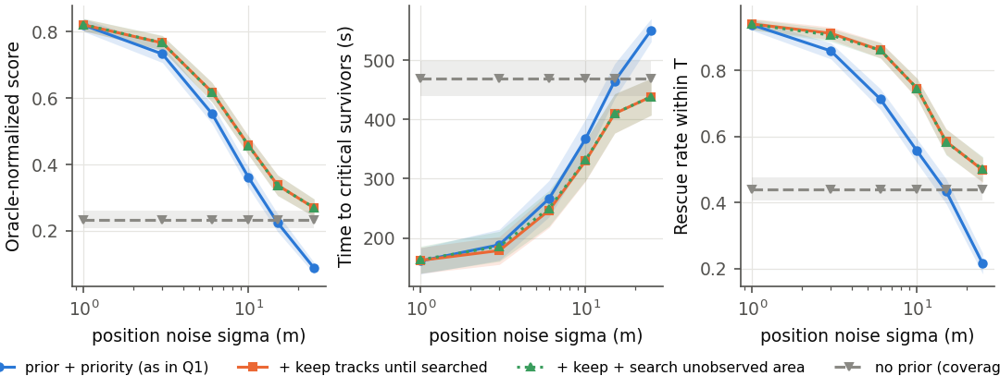

**Figure 5b.** Same metrics as Figure 1 with the retention variant added. Bands are 95% CIs over 160 sites.

**Table 5c.** Paired score difference vs. prior + priority (variant minus baseline, mean +/- 95% half-width, 160 sites; `*` = interval excludes zero, uncorrected for multiple comparisons). The rescue-rate and time-to-critical differences have the same sign.

| sigma (m) | resume | region | keep | keep, 160 fresh sites |
| --- | --- | --- | --- | --- |
| 1 | -0.000 +/- 0.005 | +0.002 +/- 0.006 | +0.001 +/- 0.005 | -0.001 +/- 0.005 |
| 3 | +0.010 +/- 0.009 | +0.006 +/- 0.010 | +0.033 +/- 0.017* | +0.056 +/- 0.020* |
| 6 | +0.001 +/- 0.010 | +0.006 +/- 0.012 | +0.065 +/- 0.027* | +0.088 +/- 0.027* |
| 10 | +0.005 +/- 0.011 | +0.005 +/- 0.012 | +0.097 +/- 0.027* | +0.103 +/- 0.026* |
| 15 | -0.003 +/- 0.009 | -0.001 +/- 0.009 | +0.113 +/- 0.028* | +0.156 +/- 0.026* |
| 25 | -0.003 +/- 0.006 | -0.004 +/- 0.005 | +0.182 +/- 0.026* | +0.166 +/- 0.027* |

- **keep is the whole effect.** `resume` and `region` change only what the robot does after it has given up on every track, and are within noise everywhere; combining them with `keep` adds nothing (`runs/retention.csv`). At sigma = 3 m, keep raises the rescue rate by +0.053 +/- 0.019 (fresh sites +0.074 +/- 0.021) and cuts time to critical by about 10 s (fresh sites 50 +/- 22 s); at sigma = 10 m, by +0.19 and 37 s (fresh sites 63 +/- 28 s).
- **It moves the break-even point.** The prior with keep still beats no-prior coverage at sigma = 25 m (0.27 vs. 0.23); without it the prior fell below coverage at about 15 m (Table 1).
- **Region size matters.** Fresh sites, score gain over the baseline at sigma = 6 / 15 m: 1-sigma region +0.034 / +0.097, 2-sigma +0.088 / +0.156, 3-sigma +0.077 / +0.133. The 1-sigma region is too small; 3 is no better than 2.
- **False positives cost less than they save.** Keep also retains spurious tracks, but at sigma = 3 m the gain holds as they increase: +0.025 +/- 0.016 (0 false positives), +0.056 (1), +0.072 (6), +0.082 (20; fresh sites).
- **A caveat on the closed-loop stack.** `StackConfig(retention="keep")` wires the same rule into the 10 Hz stack (10 m sensor, filter on, 100 sites, `scripts/ctrl_run_retention.py`). There it does not help: score difference +0.014 +/- 0.020 (sigma 3 m), +0.013 +/- 0.030 (6 m), -0.036 +/- 0.030 (10 m) and -0.033 +/- 0.019* (15 m); rescue rate -0.058 and -0.120* at 10 and 15 m. Safety is unaffected (0 clearance violations and 0 hazard entries with and without it). A plausible cause is that the closed-loop goal is the standoff of the track mean outside the safety region, so the robot holds a retained, unconfirmed track at the region's edge instead of searching its disc, and the larger sensor already sees most of what keep would add. We did not investigate, so the gain is established for the Q1-Q2 simulator (5 m sensor), not for the closed-loop stack.

## Closed-loop results: Q3-Q5

> **Note:** Tables 6-11 are from a rerun on the fixed stack (the two Go2 stack fixes on, same sites and settings). Q3 and Q5 moved by no more than noise. Q4 changed: the no-inference score in the triage regime rose from 0.59 to 0.67 (the fixes help most when the robot waits long at survivors), and the pooled full-system gain is now just detectable (+0.006 +/- 0.004). The Q4 ablation panels (`q4_ablations.png`) and the consistency check against Q1 (Table 12) were not rerun and are from the earlier stack.

Control-rate Go2 sim, T = 600 s (300 s in the Q4 triage regime). **The default safety-region confidence is 0.7 (`StackConfig.conf_p`); every closed-loop result below uses it unless a table says otherwise.** **Q3 and Q4 use 100 sites per configuration (200 for the Q4 triage regime and 300 for the violation check); Q5 uses 100 scenarios.** Every comparison between methods is paired by site (same site, same drone detections) and reported as mean +/- 95% confidence half-width; a `*` marks an interval that excludes zero, uncorrected for multiple comparisons. `scripts/ctrl_stats.py` and `scripts/ctrl_plot.py` regenerate these tables and the figures from `runs/*.csv`. Figures are committed in [`figures/closed_loop/`](figures/closed_loop/).

Differences from the Q1-Q2 simulator: sensor radius 10 m (an onboard person detector), rescue radius 3.5 m (the robot confirms from a standoff outside the 1 m clearance), and survivors can move. Q3-Q4 scores are therefore not comparable with the Q1-Q2 tables in absolute terms; the consistency check below compares the trends. The survivor behavior, the reward models and the prompt-response model are modelling choices, not calibrated to people.

### Q3: safety under uncertainty

A clearance violation is the robot centre within 1 m of any survivor (including ones already reached). Localization uncertainty is the robot's onboard measurement noise sigma_meas; the safety region is the confidence ellipse of the belief, padded by the clearance and a measured tracking error. Score is oracle-normalized (class weights).

**Table 6.** Safety filter vs. no filter (default confidence 0.7, 100 sites).

| sigma_meas (m) | Episodes with violation, full | Episodes with violation, no filter | Score, full | Score diff. (full - no filter) | Rescue-rate diff. | Time-to-critical diff. (s) |
| --- | --- | --- | --- | --- | --- | --- |
| 0.25 | 0.00 | 0.61 | 0.75 | -0.005 +/- 0.012 | +0.000 +/- 0.014 | -1.9 +/- 17.5 |
| 0.5 | 0.00 | 0.59 | 0.74 | -0.011 +/- 0.013 | -0.014 +/- 0.013* | -2.9 +/- 13.9 |
| 1.0 | 0.00 | 0.44 | 0.60 | -0.003 +/- 0.014 | -0.012 +/- 0.029 | +9.9 +/- 22.0 |
| 1.5 | 0.00 | 0.50 | 0.58 | -0.009 +/- 0.015 | -0.022 +/- 0.027 | +22.2 +/- 24.1 |
| 2.0 | 0.00 | 0.49 | 0.57 | -0.016 +/- 0.017 | +0.003 +/- 0.030 | +13.4 +/- 22.7 |


**Figure 6.** Violations, score and rescue rate vs. onboard localization noise, full system vs. no filter (lines are means over 100 sites, bands 95% CIs).

**What the filter costs, and how to reduce it.** The cost is the conservative region around survivors the robot has not yet localized. At confidence 0.9 (the previous default) it was 1 to 5 points of score and 25 to 45 s on time to critical, detectable at four of five noise levels; at the new default of 0.7 no score difference is detectable at any noise level (Table 6; one rescue-rate difference, -0.014 +/- 0.013 at sigma_meas 0.5, just excludes zero). Lowering the confidence of the region removes nearly all of it with no loss of safety:

**Table 7.** Score difference vs. no filter by confidence level of the safety region (100 sites).

| sigma_meas (m) | conf 0.5 | conf 0.7 | conf 0.8 | conf 0.9 |
| --- | --- | --- | --- | --- |
| 0.5 | -0.008 +/- 0.016 | -0.011 +/- 0.013 | -0.015 +/- 0.013* | -0.057 +/- 0.019* |
| 1.0 | -0.004 +/- 0.016 | -0.003 +/- 0.014 | +0.002 +/- 0.018 | -0.016 +/- 0.020 |
| 2.0 | -0.018 +/- 0.018 | -0.016 +/- 0.017 | -0.016 +/- 0.018 | -0.039 +/- 0.020* |

Episodes with a violation were 0 in every cell (2,400 episodes in the rerun, closest approach 2.04 m). The larger check below was run on the earlier stack and not repeated: a check at sigma_meas 1.0 and 2.0 and confidence 0.5, 0.7 and 0.9 (300 sites each, 1800 episodes) again had **0 clearance violations and 0 hazard entries**, with minimum robot-survivor distance never below 2.1 m against the 1 m requirement, so the 95% upper bound on the violation rate is about 1% per setting. The reason the lower confidence is free is that the fixed margins (1 m clearance, tracking-error pad, control-point offset) already keep the robot well clear: the region's confidence level adds little safety here but costs time. The lower levels rest on those margins; with a smaller margin the confidence level would matter again. Raising the confidence to 0.95 and 0.99 lowers the score to 0.62 and 0.52 (sigma_meas 0.5, rerun; 0.61 and 0.47 on the earlier stack). The closed-loop default is now 0.7 (`StackConfig.conf_p`) and the standalone `SafetyParams` default stays at 0.9, and Q3-Q5 were all rerun at it. The 0.9 rows in the sweeps are the earlier default.

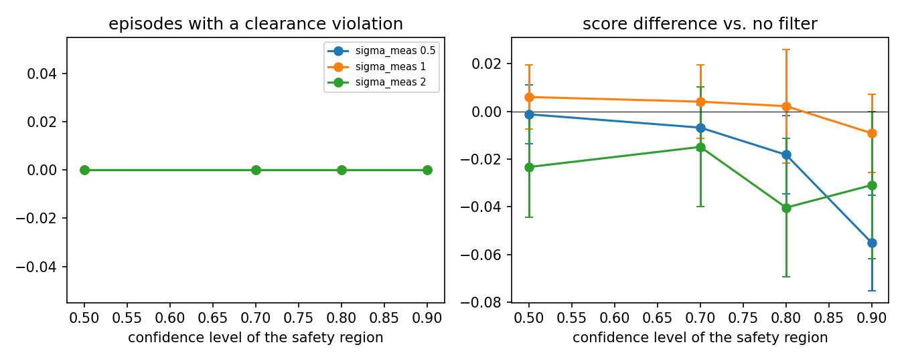

**Figure 7.** Violations and score difference vs. no filter by region confidence level, for three noise levels.

**Tried, and did not help.** Fusing all 10 Hz detections in a second (`StackConfig(avg_meas=True)`: mean with std sigma_meas/sqrt(n), so the region shrinks faster) lowered the filtered score (0.48 vs 0.59 at sigma_meas 1.0, 0.33 vs 0.51 at 2.0) and is left off.

**Hazard stress test.** With a hazard-blind planner the unfiltered stack entered a hazard in 57% of episodes and had a clearance violation in 66%; the filtered one had neither, at about 1 point of score (0.71 vs 0.72). With the hazard-aware planner neither variant entered a hazard, so the hazard barrier matters only when the planner fails.

**Answer.** Yes. The filter eliminated every clearance violation in every condition (over 4,000 filtered episodes in total), against 44-61% of unfiltered episodes with one. At the default confidence of 0.7 the cost is within noise of zero at every noise level (point estimates between -1.6 and -0.3 points at the default 0.7; the 0.9 setting cost 1 to 6), with violations still at zero. The loss from localization uncertainty itself (0.75 to 0.52 as sigma_meas grows) is larger than the filter's. The filter needs active uncertainty reduction: when the safety region is as large as the sensing range, the robot circles the region until it sees the survivor.

### Q4: survivor state

Inference quality at the default config: the full system infers the state with **87% accuracy** (communication oracle 97%, no-inference baseline 35%, the accuracy of the prior alone; rerun on 100 sites, unchanged from the earlier 86%) and settles on the right state on average **3.2 s** after the first sighting. Accuracy falls as survivors move out of model: 0.87 with no erratic survivors, 0.74 with half of the mobile survivors erratic, 0.56 with all of them, and only 37-45% on the erratic survivors themselves (see [`q4_ablations.png`](figures/closed_loop/q4_ablations.png) for the other ablations: prior noise, false positives, survivor count, fraction mobile, prompt reliability). Two of those panels need care. The prompt-reliability panel is flat because the default-scene score is insensitive to inference quality, not because reliability has no effect: state accuracy rises from 73% (q = 0.4) to 95% (q = 1.0) while the score stays at 0.742. The erratic-fraction panel rises (0.706 to 0.733) because erratic survivors do not flee the robot the way retreating ones do, so it is confounded with how hard survivors are to reach; read the accuracy numbers above for robustness.

**Does inferring the state help the rescue score?** It depends on whether state changes the best decision. We test two configurations, reported side by side.

*Default scene (reward `base`).* The state only rescales each survivor's reward (unresponsive 1.5, trapped 1.0, mobile 0.4), 3-8 survivors, T = 600 s. Here inference does nothing: state-weighted score (paired difference vs. no inference, 100 sites) is **-0.001 +/- 0.001** for the full system and **-0.000 +/- 0.001** for the communication oracle; the no-inference score is 0.737 on the rerun (paired difference -0.001 +/- 0.001 for the full system and -0.000 +/- 0.001 for the oracle; the earlier stack gave -0.003 +/- 0.006 and -0.003 +/- 0.007). The interval is tight, so this is a clean null, not an underpowered one. It is also explained: an exhaustive search over visiting orders with perfect state knowledge improves the oracle-relative score by only 0.8% (`base`), 1.1% (state-dependent decay, `conseq`) or 3.7% (stronger decay and earlier self-evacuation, `conseq_strong`) over the best order that ignores the state (25-60 sites). With 3-8 survivors the nearest-first order is close to optimal whatever their state, so the state cannot matter much, and no reward-weight tuning in this scene changes that.

*Triage regime (reward `triage`).* State must change what acting costs, not only what it is worth. Unresponsive survivors need 30 s of on-site assessment, trapped ones 15 s and mobile ones none (a prompt is enough); unresponsive survivors also deteriorate twice as fast, and mobile survivors self-evacuate after 240 s (reward 0 after that). The robot cannot reach everyone: 8 survivors, T = 300 s. Both the search layer and the oracle use this reward (the search maximizes expected reward per unit of travel plus expected handling time under its belief over the state; the oracle's best order is brute-forced with the same handling times). In this regime knowing the state is worth up to 7.9% of the score (the same exhaustive-order calculation, 25 sites; with 8 survivors and T = 600 s it is 1.9%, and 1.2% in the default scene), and inference captures part of it:

**Table 8.** State-weighted score minus the no-inference baseline, triage regime (8 survivors, T = 300 s, 200 sites).

| Drone state cue | No-inference score | Full (inference) | Communication oracle (in range) | Global oracle (all states known at t = 0, upper bound) |
| --- | --- | --- | --- | --- |
| none | 0.669 | +0.003 +/- 0.008 | +0.007 +/- 0.009 | +0.017 +/- 0.018 |
| 0.7 accuracy | 0.660 | +0.014 +/- 0.014* | +0.013 +/- 0.014 | +0.008 +/- 0.017 |

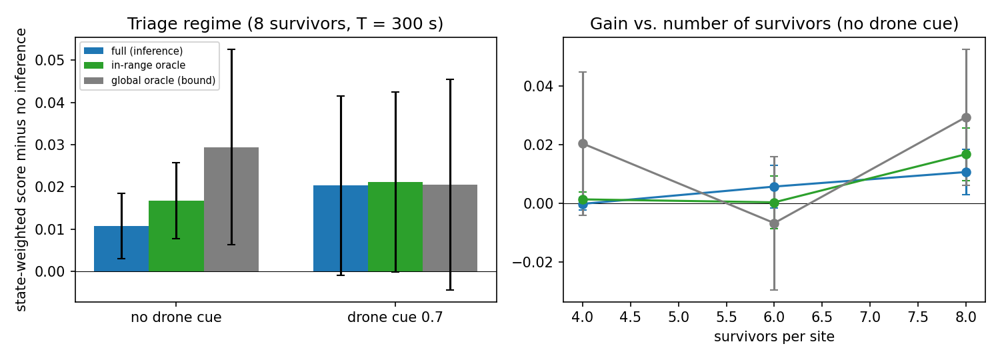

**Figure 8.** Left: paired gain over no inference in the triage regime, with and without a noisy drone state cue. Right: gain vs. number of survivors (no cue, Table 9). Bars are 95% CIs.

**Table 9.** The gain grows with how overloaded the robot is (triage regime, T = 300 s, no drone cue, 200 sites).

| Survivors | No-inference score | Full (inference) | Communication oracle (in range) | Global oracle (upper bound) |
| --- | --- | --- | --- | --- |
| 4 | 0.717 | -0.003 +/- 0.004 | -0.005 +/- 0.004* | -0.002 +/- 0.019 |
| 6 | 0.697 | +0.006 +/- 0.006 | +0.007 +/- 0.007* | +0.002 +/- 0.016 |
| 8 | 0.669 | +0.004 +/- 0.008 | +0.007 +/- 0.009 | +0.017 +/- 0.018 |

With 4 survivors the robot can reach everyone and state information is worth nothing; any gain appears only as the site becomes capacity-limited. On the fixed stack no 200-site full-system gain excludes zero (8 survivors: +0.004 +/- 0.008; the 8-survivor row differs from Table 8 by 0.001 because the two runs are separate job sets).

**Replication on fresh sites.** To check whether the 8-survivor gain was real, we reran the same configuration (no drone cue) on 500 new sites (seeds 1000 and up, disjoint from the original 200; `scripts/ctrl_run_q4_triage_large.py`, `runs/q4_triage_large.csv`):

**Table 9b.** State-weighted score minus the no-inference baseline, triage regime, 8 survivors, T = 300 s, no drone cue.

| Sites | n | No-inference score | Full (inference) | Communication oracle (in range) | Global oracle (upper bound) |
| --- | --- | --- | --- | --- | --- |
| Original | 200 | 0.669 | +0.003 +/- 0.008 | +0.007 +/- 0.009 | +0.017 +/- 0.018 |
| Fresh | 500 | 0.657 | +0.007 +/- 0.004* | +0.004 +/- 0.003* | +0.024 +/- 0.011* |
| Pooled | 700 | 0.661 | +0.006 +/- 0.004* | +0.005 +/- 0.004* | +0.022 +/- 0.009* |

On the fixed stack the full system's gain is small but now detectable on the fresh sites (+0.007 +/- 0.004) and pooled (+0.006 +/- 0.004), about half a point of score; the in-range oracle's gain is about the same (+0.005 +/- 0.004 pooled) and the global-knowledge bound is larger (+0.022 +/- 0.009). On the earlier stack the pooled full-system gain was +0.004 +/- 0.004 and not detectable. The intervals are uncorrected for multiple comparisons. The full system again had no clearance violations or hazard entries in any of the 700 episodes (the same on the 500 fresh sites).

**Answer.** Inference works (86% accurate, about 3 s to settle), but what it is worth depends on whether state changes the decision. In the default scene it is worth nothing measurable (-0.001 +/- 0.001), and a perfect-knowledge ceiling of 1-4% shows why. When the robot is capacity-limited and state sets the handling time, the full system's gain is small: +0.003 +/- 0.008 at 200 sites, +0.007 +/- 0.004 on 500 fresh sites, and +0.006 +/- 0.004 pooled over 700 (Table 9b), about half a point of score and only just detectable. The global-knowledge bound is larger (+0.022 +/- 0.009 pooled), so the full system captures at most a quarter of what perfect state knowledge could give. We would call this a small measured benefit, under a modelled triage reward, not a large one, and it was null on the earlier stack, so we would not lean on it. State information is only valuable before the robot commits to a survivor, and the onboard sensor delivers it too late to capture much of the gain. A noisy drone cue (70% accurate) gives no further detectable gain. The triage effect rests on modelling choices (handling times, decay, self-evacuation) that are not calibrated to people.

### Q5: legibility

On open ground with one distractor on the same side, mobile survivor, 100 scenarios. Three simulated observers score each approach: a cost-model observer (same family as the planner's cost term, so partly by construction), a heading-extrapolation observer, and a **learned observer**: a conditional-logit goal classifier trained on synthetic noisy-rational walkers (features: motion direction toward each goal and progress toward it), which shares neither the planner's model nor a hand-set likelihood. The planner has two legibility terms: the cost-model term (weight lambda) and a heading term (weight lambda_head) that rewards motion pointing at the true goal rather than the distractors.

**Table 10.** Mean P(true goal) over the approach and approach time, mobile survivor.

| | Approach time (s) | Cost-model observer | Heading observer | Learned observer |
| --- | --- | --- | --- | --- |
| No legibility | 19.3 | 0.77 | 0.78 | 0.89 |
| Cost term, lambda = 300 | 25.7 (+33%) | 0.91 | 0.81 | 0.94 |
| Heading term, lambda_head = 3 | 20.2 (+5%) | 0.83 | 0.83 | 0.94 |

**Table 11.** Paired differences vs. no legibility (mobile survivor; time in s, others in P(goal)).

| lambda (cost) | lambda_head | Approach time | Cost-model observer | Heading observer | Learned observer |
| --- | --- | --- | --- | --- | --- |
| 300 | 0 | +6.41 +/- 0.48* | +0.14 +/- 0.01* | +0.03 +/- 0.00* | +0.05 +/- 0.01* |
| 0 | 1 | +0.08 +/- 0.01* | +0.02 +/- 0.00* | +0.02 +/- 0.00* | +0.02 +/- 0.00* |
| 0 | 2 | +0.49 +/- 0.03* | +0.05 +/- 0.00* | +0.04 +/- 0.00* | +0.04 +/- 0.01* |
| 0 | 3 | +0.97 +/- 0.06* | +0.07 +/- 0.01* | +0.05 +/- 0.00* | +0.06 +/- 0.01* |
| 0 | 5 | +2.01 +/- 0.15* | +0.09 +/- 0.01* | +0.06 +/- 0.00* | +0.07 +/- 0.01* |
| 300 | 3 | +7.68 +/- 0.50* | +0.14 +/- 0.01* | +0.03 +/- 0.00* | +0.05 +/- 0.01* |
| 300 | 5 | +8.58 +/- 0.51* | +0.15 +/- 0.01* | +0.03 +/- 0.00* | +0.04 +/- 0.01* |

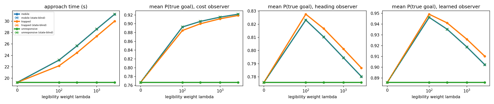

**Figure 9.** Legibility weight vs. approach time and each observer's mean P(true goal), by true survivor state and for a state-blind planner (dashed).

(Q5 was rerun on the fixed stack: the approach scenarios are unchanged to within 0.01 in every cell.)

**Answer.** Yes, and the result no longer rests on one observer model: both terms raise P(true goal) for all three observers, including the independent learned one (cost term +0.05 +/- 0.01, heading term +0.06 +/- 0.01). They differ in cost. The cost term at lambda = 300 buys its gain at about a third more approach time (+6.4 s); the heading term at lambda_head = 3 buys a slightly larger gain for the learned observer (+0.06) and a larger one for the heading observer (+0.05 vs. +0.03), for about 1 s (+5%). Raising lambda_head to 5 adds a little more (learned +0.07, heading +0.06) for 2 s (+10%). Combining the two terms adds time without adding to the independent observers' gain (lambda = 300 with lambda_head = 5: +8.6 s, learned +0.04). At the earlier 0.9 confidence default, lambda_head = 5 made the robot hover and lose legibility; that failure did not reproduce at 0.7, so we do not claim a narrow useful range, only diminishing returns above about 3. The cost-model observer's gain is still partly by construction. Weighting by inferred state removes the cost for unresponsive survivors (19.3 s, no change) and lowers it for trapped ones, whereas a state-blind planner pays the full cost for everyone.

### Consistency with Q1-Q2

The two simulators differ on purpose, so we compare trends. Running the closed-loop sim over the Q1 prior sweeps (safety filter off, 100 sites, class-weighted score) and comparing relative score (score / score at the best setting) with the frozen Q1 tables (`scripts/ctrl_run_consistency.py`):

**Table 12.** Relative score (score / best setting): closed-loop sim vs. frozen Q1.

| Position noise sigma (m) | 1 | 3 | 6 | 10 | 15 | 25 |
| --- | --- | --- | --- | --- | --- | --- |
| Frozen Q1 | 1.00 | 0.90 | 0.69 | 0.48 | 0.32 | 0.12 |
| Closed-loop, 5 m sensor (as in Q1) | 1.00 | 0.85 | 0.65 | 0.46 | 0.27 | 0.14 |
| Closed-loop, 10 m sensor (default) | 1.00 | 0.94 | 0.88 | 0.76 | 0.68 | 0.49 |

| False positives per site | 0 | 1 | 3 | 6 | 10 | 20 |
| --- | --- | --- | --- | --- | --- | --- |
| Frozen Q1 | 1.00 | 0.92 | 0.86 | 0.78 | 0.67 | 0.58 |
| Closed-loop, 5 m sensor | 1.00 | 0.98 | 0.95 | 0.86 | 0.75 | 0.63 |
| Closed-loop, 10 m sensor (default) | 1.00 | 0.93 | 0.87 | 0.83 | 0.69 | 0.65 |

Both sims degrade monotonically (Spearman -1.00) in both sweeps. With the same 5 m sensing range the closed-loop sim reproduces the Q1 noise curve to within 0.05 in relative score; the default 10 m sensor flattens it (relative score 0.49 vs. 0.12 at sigma 25), because a wider sensor finds survivors that a poor prior misplaces. The false-positive curves agree within 0.07 (10 m) and 0.09 (5 m). The closed-loop sim is therefore consistent with the frozen Q1 trends, and the differences are explained by the sensing range.

**Which implementation drives the closed loop.** The standalone components (`mpc.py` MPPI planner, `cbf.py` filter, `clearance.py`, `observer.py`, `behavior.py`) and the closed-loop modules (`ctrl_mpc.py`, `safety.py`, `stack.py`, `ctrl_sim.py`, `ctrl_behavior.py`) were compared by running both controllers in the same control-rate simulation (`StackConfig(controller="closed_loop" | "components")`), 30 sites, same search layer, sensors and survivors (run before the Q3-Q5 changes above, so at the earlier safety-region confidence of 0.9, and not rerun at 0.7; the comparison is of the controllers, not of the confidence level):

| sigma_meas (m) | controller | filter | score | rescue rate | episodes with clearance violation |
| --- | --- | --- | --- | --- | --- |
| 0.5 | closed-loop (`ctrl_mpc` + `safety`) | on | 0.72 | 0.88 | 0.00 |
| 0.5 | components (`mpc` + `cbf`) | on | 0.58 | 0.78 | 0.00 |
| 0.5 | closed-loop | off | 0.78 | 0.94 | 0.50 |
| 0.5 | components | off | 0.66 | 0.90 | 0.60 |
| 1.5 | closed-loop | on | 0.57 | 0.75 | 0.00 |
| 1.5 | components | on | 0.50 | 0.74 | 0.00 |
| 1.5 | closed-loop | off | 0.62 | 0.85 | 0.40 |
| 1.5 | components | off | 0.63 | 0.87 | 0.67 |

Both filters eliminate clearance violations. The closed-loop controller is the default for all reported Q3-Q5 numbers because it was developed and tuned for this simulator; **the components controller was not retuned**, so this table compares a tuned controller with an untuned one and the speed gap is not evidence that the closed-loop design is intrinsically better. The standalone components are kept: the Bayes mode filter, terrain-aware observer and clearance regions are tested on their own (`tests/test_*`), and their controller can be switched in with `controller="components"`. It was not retuned for this simulator (its standoff is 1.2 m and it was written against a 1.5 m rescue radius).

### Compute cost per layer

`scripts/profile_layers.py` times each layer's calls with `perf_counter` on an otherwise idle machine (single process, Python, reduced-order unicycle plant, 6 sites of up to 300 s simulated; `runs/profile.csv`). A 10 Hz layer has a 100 ms budget.

**Table 12b.** Cost per call (ms), full stack.

| Layer | Rate | Calls | Mean | 95th pct | Max |
| --- | --- | --- | --- | --- | --- |
| Search, belief, route and inference (`plan`) | 1 Hz | 1335 | 1.00 | 1.59 | 3.90 |
| of which belief update and target selection | 1 Hz | 1335 | 0.42 | 0.87 | 2.95 |
| of which terrain route planner | 1 Hz | 1335 | 0.56 | 0.74 | 1.68 |
| of which survivor-state inference | 1 Hz | 1335 | <0.01 | <0.01 | 0.44 |
| Approach MPC | 10 Hz | 13334 | 0.24 | 0.38 | 1.17 |
| CBF safety filter | 10 Hz | 13334 | 0.08 | 0.16 | 1.13 |

Every layer is far inside its budget: the 10 Hz control step (MPC plus filter) costs about 0.32 ms, 0.3% of 100 ms. Removing state inference changes nothing measurable (plan 1.09 ms vs. 1.00 ms; the inference function itself is negligible), so cutting it would save no compute; the reason to cut it, if any, is complexity and the small measured benefit. Adding the cost-model legibility term raises the MPC mean from 0.24 to 0.28 ms and the heading term to 0.30 ms (with one 9.1 ms outlier). So legibility's cost is mostly in approach time (+33% vs. +5%, Q5), not compute. The per-layer fractions of simulator wall time (MPC about half, filter about 17%) include the simulator itself and are not a robot budget.

What this does not measure: the Go2 policy inference and physics step, the drone detector and the onboard person detector (neither is run here), and a robot-class processor, which would be slower than this laptop; the claim is that the planning stack is not the bottleneck, not a hardware latency figure.

## MuJoCo Go2 with a learned locomotion policy (initial results)

*Training, versions, rubble terrain and step-by-step reproduction are in [`sim.md`](sim.md).*

The results above use a reduced-order unicycle as the robot. Here the same stack drives a full Go2 model in MuJoCo, walking with a learned locomotion policy. The proposal planned this in Isaac Sim / Isaac Lab; it was done in MuJoCo instead, with the policy trained in mjlab (MuJoCo Warp). These are first results on fewer sites than the tables above (40 and 20 instead of 100).

Running the stack on the Go2 exposed a planner deadlock and a belief bug, both fixed below ([Planner fixes](#planner-fixes-found-on-the-go2)). Every number in this section uses the fixed stack, on both plants. **The Q3-Q5 closed-loop tables in the sections above were produced before these fixes** and have not been re-run (Q1-Q2 do not use this stack).

**Setup.**
- **Policy.** `Unitree-Go2-Flat` from [`unitree_rl_mjlab`](https://github.com/unitreerobotics/unitree_rl_mjlab): velocity tracking, PPO, 3000 iterations with 4096 environments (about 295M steps, 1 h 23 min on one laptop RTX 5070 Ti under WSL2). At the end of training, episodes ran the full 20 s with almost no falls.
- **Rough-terrain policy.** `Unitree-Go2-Rough`, 3000 iterations with 2048 environments (4096 did not fit this GPU), about 1 h 55 min; its actor also takes a 17 x 11 height scan. Used only in [Physical rubble](#physical-rubble); everything else uses the flat policy. Details in [`sim.md`](sim.md).
- **Plant.** `rescue/mj_plant.py` rebuilds the training robot in MuJoCo 3.5.0 (position actuators with the training gains, feet-only collision, the training solver settings) and runs the exported policy at 50 Hz on 200 Hz physics. Joint order, default pose, gains, action scale and the observation layout are read from, and checked against, the policy file's metadata.
- **Interface.** The stack's 10 Hz `(v, omega)` command becomes the policy's velocity command, clipped to its training range (forward speed -0.5 to 1.0 m/s, yaw rate +/-1.0 rad/s), and the pose comes back from the simulated robot. On this plant the planner and filter also plan with the 1.0 rad/s turn rate (the unicycle uses 1.5).
- **Unchanged.** The drone detections (`drone_prior.py` noise model), survivors and sensing. In the checks before [Physical rubble](#physical-rubble) the ground is a flat plane and rubble is only a speed cap in the stack; that section adds a heightfield and a policy trained on rough terrain.

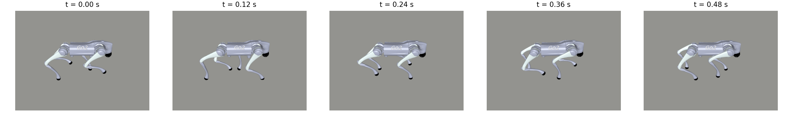

**Figure 10.** The trained policy walking at 1.0 m/s, one 0.6 s gait cycle.

**Tracking** (`scripts/mj_calibrate.py`). The robot stood, walked and turned without falling. It walks about 10% slower than commanded and turns close to the commanded rate.

**Table 13.** Commanded vs. achieved speed and yaw rate (steady state, 3 s).

| Command | 0.3 m/s | 0.6 m/s | 1.0 m/s | 0.5 rad/s | 1.0 rad/s | -1.0 rad/s |
| --- | --- | --- | --- | --- | --- | --- |
| Achieved | 0.25 m/s | 0.54 m/s | 0.91 m/s | 0.43 rad/s | 0.95 rad/s | -1.00 rad/s |

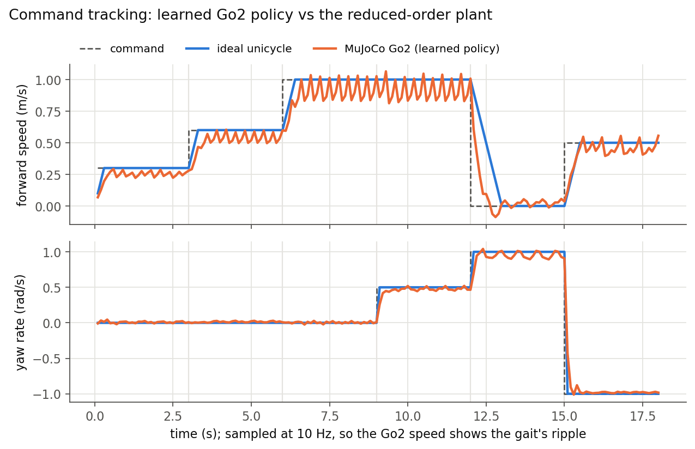

**Figure 11.** A sequence of speed and turn commands, sent at 10 Hz as the stack sends them, on both plants. The Go2's speed ripples with its gait and settles below the command; it stops faster than the unicycle's 1 m/s^2 limit.

**Tracking-error pad.** This is the same measurement as `safety.calibrate_tracking_error`: the gap between where the robot ends up and where the planner's ideal unicycle would be, after 1 s of random constant commands (400 samples, no falls).

**Table 14.** Tracking error after 1 s.

| Plant | median | 95% | 99% | max |
| --- | --- | --- | --- | --- |
| MuJoCo Go2 | 0.077 m | 0.190 m | 0.250 m | 0.284 m |
| Reduced-order unicycle (the previous measurement) | | 0.256 m | | |

The pad in use, 0.25 m, covers the Go2's 95% gap, so it was left unchanged.

### Q3 on both plants

`scripts/mj_run_q3.py`: 40 sites, sigma_meas 0.5 m, confidence 0.7, the same sites and drone detections on both plants.

**Table 15.** Q3 on the unicycle and on the MuJoCo Go2.

| Plant | Variant | Score | Rescue rate | Episodes with clearance violation | Min. distance (m) | Falls |
| --- | --- | --- | --- | --- | --- | --- |
| Unicycle | full | 0.775 | 0.93 | 0.00 | 2.42 | - |
| MuJoCo Go2 | full | 0.716 | 0.93 | 0.00 | 2.41 | 0 |
| Unicycle | no filter | 0.788 | 0.93 | 0.50 | 0.05 | - |
| MuJoCo Go2 | no filter | 0.726 | 0.94 | 0.53 | 0.07 | 0 |

- **Safety carries over.** With the filter, no episode had a violation on either plant; without it, about half did on both.
- **The legged robot costs score, the filter does not.** Paired by site, the Go2 scores 0.059 +/- 0.018 below the unicycle with the filter and 0.062 +/- 0.020 below it without, so the gap comes from the plant, not the filter. It rescues as many survivors; it gets to them later, because it walks slower than the search layer's travel-time estimates assume. The filter's own cost is within noise on both plants (-0.013 +/- 0.017 on the unicycle, -0.010 +/- 0.023 on the Go2).
- **Closest approaches match.** With the filter, the Go2's closest approach per site is within 0.06 m of the unicycle's on average (0.30 m at most).

**100-site replication.** The same check on 100 sites (`scripts/mj_run_q3.py 100`, 400 episodes, same sites and detections on both plants): score unicycle full 0.738, Go2 full 0.674, unicycle no filter 0.749, Go2 no filter 0.685; rescue rate 0.90-0.92 in all four. With the filter there were **0 clearance violations and 0 hazard entries on both plants, closest approach 2.39 m (unicycle) and 2.41 m (Go2), and no falls**; without it 59% of episodes violated on both (closest 0.04 and 0.03 m). Paired by site, the Go2 scores 0.064 +/- 0.015 below the unicycle both with and without the filter, and the filter's own cost is within noise on both plants (-0.011 +/- 0.013 unicycle, -0.011 +/- 0.015 Go2). The Go2 reaches critical survivors later (+23.9 +/- 16.8 s, filtered) at an unchanged rescue rate (+0.003 +/- 0.017). This tightens the 40-site gap estimate (0.059 +/- 0.018) and supports the same reading.

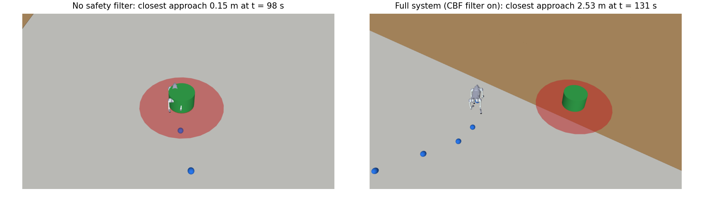

**Figure 12.** Site 0 on the Go2, same detections, each run at its closest approach to a survivor, with the 1 m required-clearance ring. Without the filter the robot walks to within 0.15 m of the survivor; with it, it stays 2.53 m away. Both runs rescue all 6 survivors.

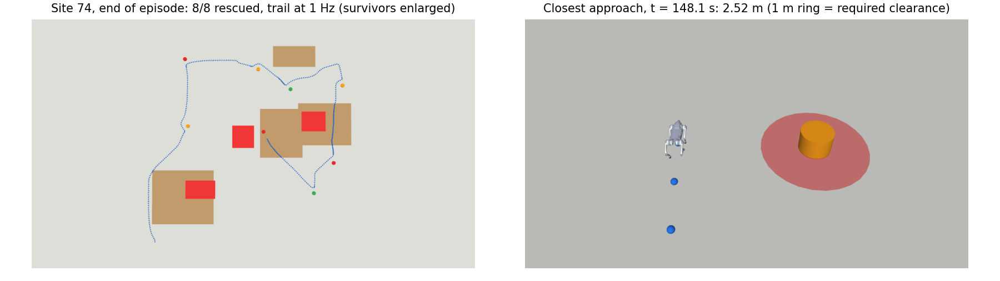

**Figure 13.** Site 74, the site of the unicycle rollout figure ([`rollout_site_074.png`](figures/closed_loop/rollout_site_074.png)), run by the full stack on the MuJoCo Go2. Left: the whole episode from above, with the robot's trail at 1 Hz (rubble tan, hazards red, survivors colored by class and drawn enlarged). Right: the closest approach to a survivor, with the 1 m ring. All 8 survivors rescued. Overlays are drawn for the figure and have no physics.

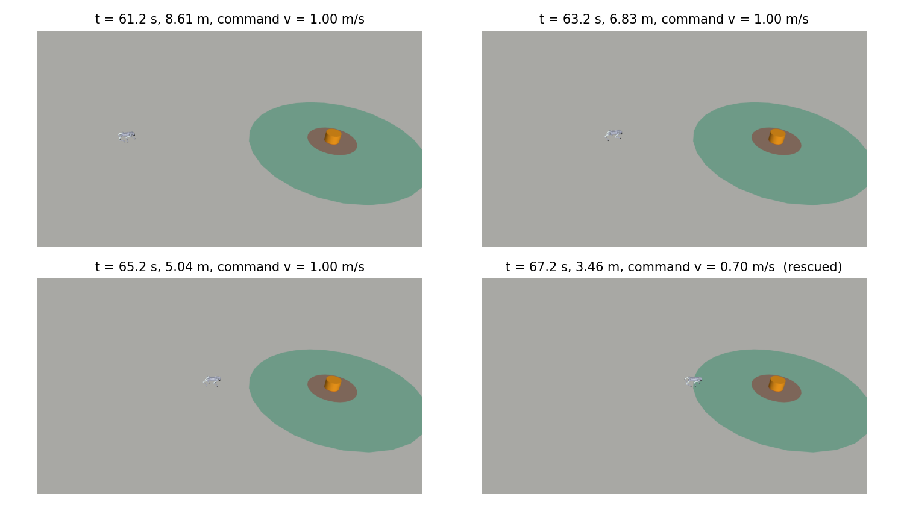

**Figure 14.** The first rescue at site 74: the Go2 walks in at the commanded 1 m/s, the stack slows it as it nears its standoff, and the survivor counts as reached at 3.5 m (green ring: rescue radius; red ring: 1 m clearance).

### Planner fixes found on the Go2

In the first Go2 runs, site 6 rescued 1 of 8 survivors against 8 of 8 on the unicycle, without the robot falling. Logging the stack's internal state at every step showed the cause, and checking the fix on other sites turned up a second bug.

1. **Deadlock at a rescued survivor.** After rescuing a survivor at 31 s, the next target lay 41 m away on the far side of it. The route (a grid path) ran straight through the rescued survivor's keep-out region, which the MPC only treats as a soft cost. The Go2, planned with a 1.5 rad/s turn rate it cannot follow, was still at the region's edge when the MPC started going around, and from there every 2 s rollout cost more than standing still. It stood still for 516 s. The safety filter never intervened and the robot was never inside a region. **Fix:** the route goes around other survivors' regions and rescued survivors' keep-outs (`StackConfig.route_around_regions`), and on the Go2 the stack plans with the turn rate the policy can follow.
2. **Waiting for a survivor who has left.** With the route fix, two sites at sigma_meas 1 m (16 and 18) stalled in a new way. A frightened survivor walked away faster than the robot's slow final approach, left sensor range, and its track stayed where it was last seen. A confirmed track never lost existence probability, and a rule that keeps the current target while the robot is within 4 m of it ("finish the survivor being handled") held the robot at that empty standoff for the rest of the episode. **Fix:** missed detections now lower a confirmed track's existence too (`StackConfig.forget_stale_tracks`), and the hold rule lets go once the track has faded. A re-detection restores the track at once.

Both are on by default; setting either flag to `False` restores the old behavior. `tests/test_stack.py` rebuilds the site 6 situation from the logged state and checks that the robot now gets past the survivor; `tests/test_belief.py` checks that a confirmed track fades when nobody is there. `scripts/diag_stall.py` reruns the affected sites with the old stack, the route fix alone and both fixes: site 16 went from 1/6 (route fix alone) to 6/6, site 18 from 2/7 to 7/7.

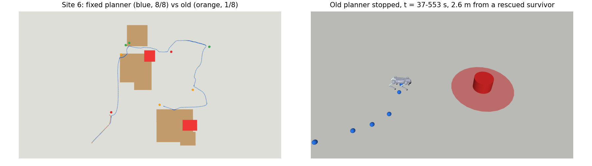

**Figure 15.** Site 6 on the Go2. Left: the fixed planner's path (blue, all 8 rescued) and the old planner's path until it stops (orange; the two coincide for the first 30 s, so it shows only near the start). Right: the old planner standing still next to the survivor it had just rescued, with the next target on the far side.

Across all 400 episodes of Tables 15 and 16, the fixes left every mean within noise (paired against the same runs before the fixes: changes between -0.024 and +0.043, all intervals including zero) and changed no safety result. Single sites still move in both directions, as expected once two runs' paths diverge. One unicycle site (32) lost a survivor it had found before: the robot searched for 425 s without a track for it, most likely because two nearby survivors shared one track and the track went when the first was rescued. That association weakness predates the fixes and is not addressed.

### Smaller safety regions

`scripts/mj_run_conf.py`: 20 sites, sigma_meas 1.0 m, filter on, 240 episodes. No episode had a violation in any setting on either plant. The closest approach stayed at least 2.08 m, so the margins never got thin enough for the tracking-error pad to matter; the pad moves the closest approach out by about its own size.

**Table 16.** Smaller safety regions, pad on and off.

| Confidence | Pad (m) | Score, unicycle | Score, Go2 | Min. distance, unicycle (m) | Min. distance, Go2 (m) |
| --- | --- | --- | --- | --- | --- |
| 0.5 | 0 | 0.643 | 0.630 | 2.08 | 2.09 |
| 0.5 | 0.25 | 0.628 | 0.600 | 2.33 | 2.35 |
| 0.7 | 0 | 0.677 | 0.597 | 2.20 | 2.28 |
| 0.7 | 0.25 | 0.642 | 0.619 | 2.48 | 2.43 |
| 0.9 | 0 | 0.637 | 0.604 | 2.47 | 2.46 |
| 0.9 | 0.25 | 0.613 | 0.593 | 2.64 | 2.71 |

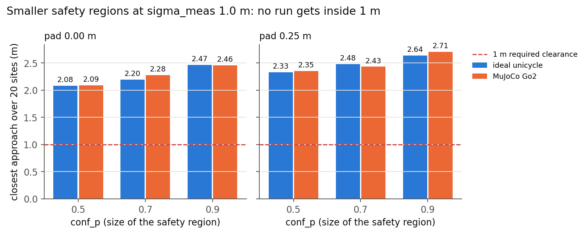

**Figure 16.** Closest approach to any survivor over the 20 sites, per setting and plant, against the 1 m required clearance.

### Head-on stress test

`scripts/mj_cbf_stress.py`. A controller walks the robot straight at a survivor whose position is known exactly, at 0.5 or 1.0 m/s, and the safety filter is the only thing that stops it. The filter guarantees a distance of at least the 1 m clearance plus the pad (for the model it assumes), and head-on it should stop 0.5 m beyond the clearance plus the pad (its barrier sits 0.25 m ahead of the robot with another 0.25 m of margin). Six runs per row. This test uses the filter alone, so the planner fixes do not affect it.

**Table 17.** Head-on stress test, 0.5 and 1.0 m/s pooled.

| Pad (m) | Guaranteed distance (m) | Unicycle stops at (m) | MuJoCo Go2 stops at (m) | Runs inside the guarantee | Runs inside 1 m | Falls |
| --- | --- | --- | --- | --- | --- | --- |
| 0 | 1.00 | 1.50 | 1.61 | 0 | 0 | 0 |
| 0.25 | 1.25 | 1.75 | 1.86 | 0 | 0 | 0 |

The values are the same at both speeds to within 0.01 m. The Go2 stops about 0.1 m short of the unicycle rather than overshooting, which fits it under-tracking the commanded speed while the filter brakes.

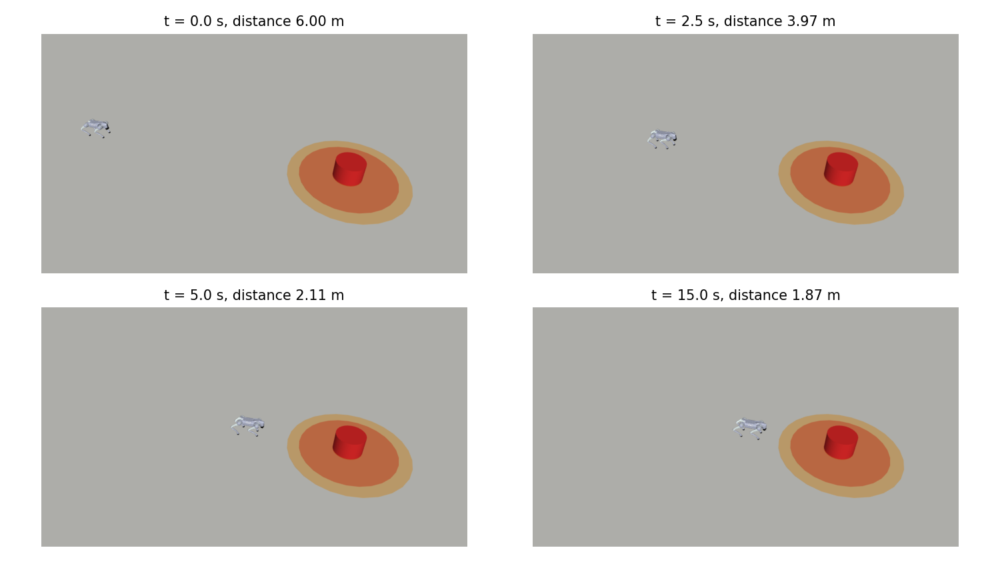

**Figure 17.** Head-on stress test at 1.0 m/s with the pad on. Rings: 1.0 m required clearance (red) and the filter's 1.25 m bound (orange).

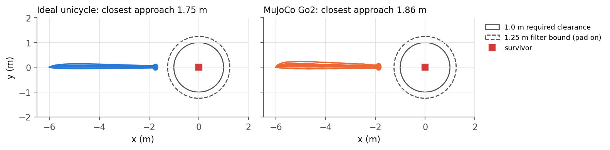

**Figure 18.** The same test from above, six starting headings per plant (dots: where each run stopped).

### Sudden close-range threat

`scripts/mj_sudden_threat.py`. The head-on test starts 6 m from a survivor the filter has known all along, so the barrier is never violated at the first step. Here the robot walks toward a far goal at 0.5 or 1.0 m/s with no survivor known, and after 3 s a survivor estimate appears 1.5, 2, 2.5, 3, 4 or 6 m ahead (the true survivor is there; the estimate carries the 0.5 m onboard measurement noise). This is what happens when the drone missed a survivor and the onboard detector sees them late, or a track jumps close. The nominal controller never slows down, so only the filter (confidence 0.7, pad 0.25 m, as in the stack) can stop the robot. Three versions: the estimate stays at its first noisy value (worst case), or the robot re-detects (90% detection probability) and Kalman-fuses each detection into the estimate, either at 10 Hz or at 1 Hz. **The stack's belief updates at 1 Hz, one detection per second**; the 10 Hz version corresponds to the optional `avg_meas` fusion, which is off by default (an earlier version of this section called the 10 Hz case "as in the stack"; it is not). Table 18 is the first run (10 seeds x 2 lateral offsets per cell, both plants, 960 filtered runs and 960 unfiltered); the 1 Hz rows and the sweep below use 30 seeds (60 runs per cell).

**Table 18.** Filtered runs that came within 1 m of the true survivor, out of 20 per cell (closest approach in m in brackets), by how far ahead the estimate appeared.

| Version | Plant, speed (m/s) | 1.5 m | 2.0 m | 2.5 m | 3.0 m | 4.0 m | 6.0 m |
| --- | --- | --- | --- | --- | --- | --- | --- |
| Fused | unicycle 0.5 | 0 (1.40) | 0 (1.85) | 0 (2.20) | 0 (2.21) | 0 (2.25) | 0 (2.45) |
| Fused | unicycle 1.0 | 0 (1.07) | 0 (1.57) | 0 (1.95) | 0 (2.12) | 0 (2.09) | 0 (2.08) |
| Fused | Go2 0.5 | 0 (1.42) | 0 (1.90) | 0 (2.22) | 0 (2.25) | 0 (2.29) | 0 (2.62) |
| Fused | Go2 1.0 | 0 (1.34) | 0 (1.82) | 0 (2.07) | 0 (2.12) | 0 (2.08) | 0 (2.11) |
| One estimate | unicycle 1.0 | 4 (0.55) | 2 (0.64) | 2 (0.64) | 2 (0.64) | 2 (0.64) | 1 (0.75) |
| One estimate | Go2 1.0 | 2 (0.64) | 2 (0.65) | 2 (0.66) | 2 (0.66) | 2 (0.74) | 1 (0.74) |

Without the filter every run violated, except where the survivor appeared 6 m ahead of a robot walking at 0.5 m/s (it never got there in time). No falls.

- **With 10 Hz re-detection the filter holds** down to a 1.5 m appearance at full speed: 0 of 480 filtered runs came within 1 m (0 of 1,440 in the 30-seed rerun), and the closest approach was 1.07 m (unicycle) and 1.34 m (Go2), both at 1 m/s and a 1.5 m appearance, so the margin there is thin. **This is not the stack's update rate.** At 1 Hz it does not hold at 1.5 m and 1 m/s (Table 18b). Table 18b is itself optimistic about the stack; see Table 18e.
- **With one bad sighting it can be beaten.** The violations in the one-estimate rows come from the seeds whose first estimate was off by 1.0 m or more (the median first-sighting error was 0.43 m). The filter keeps about 2.3-2.5 m from the *estimate*, so a first sighting wrong by more than roughly 1.3 m toward the robot, never corrected, puts the robot inside 1 m of the true survivor. At confidence 0.7 the region around a fresh track is small (0.8 m), so this is where a higher confidence would matter again, at the cost reported in Q3. The 1.5-2 m appearances are also partly unavoidable, since the barrier is already violated when the survivor appears.
- **The Go2 behaves like the unicycle**, with 0.1-0.3 m more margin at 0.5 m/s, consistent with Table 17.

**Table 18b.** The same test with 1 Hz re-detection, the stack's belief update rate (`scripts/mj_sudden_fresh.py`, 30 seeds x 2 lateral offsets = 60 filtered runs per cell). Runs within 1 m of the true survivor, closest approach in m in brackets. Top: confidence 0.7 everywhere (the stack's default). Bottom: confidence 0.99 on fresh tracks (fewer than 5 detections fused), 0.7 after.

| Confidence | Plant, speed (m/s) | 1.5 m | 2.0 m | 2.5 m | 3.0 m | 4.0 m | 6.0 m |
| --- | --- | --- | --- | --- | --- | --- | --- |
| 0.7 | unicycle 0.5 | 0 (1.08) | 0 (1.44) | 0 (1.67) | 0 (1.73) | 0 (1.96) | 0 (2.26) |
| 0.7 | unicycle 1.0 | **7** (0.39) | 0 (1.12) | 0 (1.50) | 0 (1.59) | 0 (1.68) | 0 (1.78) |
| 0.7 | Go2 0.5 | 0 (1.18) | 0 (1.52) | 0 (1.72) | 0 (1.79) | 0 (2.01) | 0 (2.53) |
| 0.7 | Go2 1.0 | **2** (0.72) | 0 (1.32) | 0 (1.56) | 0 (1.63) | 0 (1.71) | 0 (1.81) |
| 0.99 fresh | unicycle 0.5 | 0 (1.14) | 0 (1.78) | 0 (2.14) | 0 (2.19) | 0 (2.21) | 0 (2.33) |
| 0.99 fresh | unicycle 1.0 | **5** (0.62) | 0 (1.29) | 0 (1.96) | 0 (2.09) | 0 (2.00) | 0 (2.06) |
| 0.99 fresh | Go2 0.5 | 0 (1.21) | 0 (1.88) | 0 (2.15) | 0 (2.20) | 0 (2.22) | 0 (2.55) |
| 0.99 fresh | Go2 1.0 | **1** (0.90) | 0 (1.66) | 0 (2.04) | 0 (2.11) | 0 (2.11) | 0 (2.07) |

At the stack's rate, 9 of 1,440 filtered runs violate, all at a 1.5 m appearance and 1 m/s, where the barrier is already breached when the survivor appears; from 2 m on, none. **That is a lower bound for the real stack, not its result: the stand-alone test has no detection latency (Table 18e).**

#### Through the real stack

`scripts/mj_sudden_stack.py`. The stand-alone test hands the filter the estimate at t = 3.0 s, which is a plan tick, and re-detects on later ticks. In the stack a first sighting reaches the belief only at the next 1 Hz plan tick, and the belief gets one 10 Hz sample per second, which is a hit 90% of the time. So the stand-alone numbers could be optimistic. Here `run_episode_ctrl` runs the whole stack (belief, 1 Hz search and plan, MPC, CBF filter): the drone found a goal survivor 25 m ahead (exact prior) and missed a second one at x = 10 m on the path (lateral offset 0 or 0.7 m). The onboard sensor radius is set to the appearance distance, so the missed survivor is first sensed that far away; the rescue radius is 0 so the robot never "rescues" (and so never learns the position of) the survivor it should not know about. Violation = robot centre within 1 m of the missed survivor at any 10 Hz control step. 30 seeds x 2 offsets = 60 runs per cell, both plants (flat MuJoCo Go2), no falls. Measured on the 1,440 filtered runs: the survivor was always sensed and always reached the belief, with a **sense-to-belief latency of 0.63 s on average (median 0.60, 90th percentile 1.4, maximum 2.5 s)**, which is the extra distance of 0.4 m on average (up to 2.5 m) the robot walks before the filter knows.

**Table 18e.** Runs (of 60) within 1 m of the missed survivor, full stack (MPC + filter) and MPC without the filter, by distance at which the survivor is first sensed.

| Plant, speed (m/s) | Variant | 1.5 m | 2.0 m | 2.5 m | 3.0 m | 4.0 m | 6.0 m |
| --- | --- | --- | --- | --- | --- | --- | --- |
| unicycle 0.5 | full | 14 | 1 | 0 | 0 | 0 | 0 |
| unicycle 0.5 | no filter | 34 | 5 | 0 | 0 | 0 | 0 |
| unicycle 1.0 | full | 12 | **19** | 3 | 3 | 0 | 0 |
| unicycle 1.0 | no filter | 33 | 34 | 2 | 6 | 1 | 0 |
| Go2 0.5 | full | 2 | 1 | 0 | 0 | 0 | 0 |
| Go2 0.5 | no filter | 9 | 2 | 0 | 0 | 0 | 0 |
| Go2 1.0 | full | 8 | **14** | 2 | 0 | 0 | 0 |
| Go2 1.0 | no filter | 14 | 20 | 4 | 0 | 0 | 0 |

- **The stand-alone test was optimistic.** 79 of 1,440 filtered runs (5.5%) violate through the stack, against 9 of 1,440 in Table 18b, and the violations are not confined to the 1.5 m cell: at 1 m/s they reach 2.0 m (19 of 60 on the unicycle, 14 on the Go2) and 2.5-3.0 m (up to 3 of 60). Even at 0.5 m/s the unicycle has 14 of 60 at 1.5 m. The statement "no violation from 2 m on at the stack's update rate" was wrong for the stack.
- **The latency explains it.** Violation rate rises with sense-to-belief latency: 11 of 458 runs with under 0.5 s, 26 of 793 at 0.5-1 s, 36 of 175 at 1-2 s and 6 of 14 beyond 2 s. A survivor first sensed 2 m ahead at 1 m/s behaves like the stand-alone 1.5 m case once 0.5-1 s has passed.
- **The filter still helps** (79 violating runs with it against 164 with the MPC alone), and the Go2 is better than the unicycle, but the margin the filter needs at a first sighting is not there below about 3 m at full speed.
- **`conf_fresh` was not applied by the stack's filter; now it is, and it barely helps.** `CBFFilter.filter` used one confidence for every track, so the option reached only the standoff goal and router (79 violating runs, identical to the default). The filter now accepts an optional per-track confidence (`(mu, Sigma, confidence)`) and the stack passes `conf_fresh` for fresh tracks. With `conf_fresh = 0.99`, `n_fresh = 5` through the stack: 77 violating runs instead of 79 (`fresh99` rows of `runs/mj_sudden_stack.csv`). A larger region cannot fix a belief that learns of the survivor 0.6 s late. The rubble cost in Table 18d was measured before this change (it then measured only the standoff effect) and has not been rerun with the filter active. The option is off by default.
- **A 10 Hz first-detection path fixes most of it (prototype, `StackConfig(fast_detect=True)`, off by default).** An onboard detection that no confirmed belief track explains becomes a provisional track in the filter at the next control step (sigma 0.5 m, fused at 10 Hz, dropped once the 1 Hz belief holds the survivor or after 5 s); the belief, search and MPC are unchanged. Through the same 1,440 runs: **11 violating runs instead of 79** (10 with `conf_fresh = 0.99`); the unicycle at 1 m/s and 1.5 m has 10 of 60, one run at 2.5 m, and nothing else (Go2: 0 of 1,440 on both speeds; unicycle 0.5 m/s: 0). The remaining 10 are the case already inside the barrier when the estimate appears. No falls.

**Table 18f.** Runs (of 60) within 1 m, full stack with and without the 10 Hz first-detection path.

| Plant, speed (m/s) | Path | 1.5 m | 2.0 m | 2.5 m | 3.0 m | 4.0 m | 6.0 m |
| --- | --- | --- | --- | --- | --- | --- | --- |
| unicycle 0.5 | off / on | 14 / 0 | 1 / 0 | 0 / 0 | 0 / 0 | 0 / 0 | 0 / 0 |
| unicycle 1.0 | off / on | 12 / 10 | 19 / 0 | 3 / 1 | 3 / 0 | 0 / 0 | 0 / 0 |
| Go2 0.5 | off / on | 2 / 0 | 1 / 0 | 0 / 0 | 0 / 0 | 0 / 0 | 0 / 0 |
| Go2 1.0 | off / on | 8 / 0 | 14 / 0 | 2 / 0 | 0 / 0 | 0 / 0 | 0 / 0 |

- **The 10 Hz path costs nothing on the closed-loop benchmark, but this benchmark does not exercise it.** `scripts/ctrl_run_fast_detect.py`, unicycle, 100 sites, sigma_meas 0.5 m, full stack: score 0.738 with the path off and on, rescue rate 0.90, no clearance violations or hazard entries, closest approach 2.39 m in both; the paired score difference is +0.000 +/- 0.000. Only 1 of 100 sites differs at all (site 81: 0.8501 vs 0.8508). Provisional tracks do occur (one at a time in the sites I checked), and are dropped as soon as the belief holds the survivor, so with the 10 m sensor they sit far from the robot and never constrain it. This shows the path is harmless where survivors are seen early; it does not show a benefit there. Rubble and the MuJoCo Go2 were not rerun.
- **Not tested here:** a detector that sees farther than the appearance distance (the stack's 10 m sensor would normally see a survivor the drone missed long before 2 m; these runs ask what happens if it does not, for example behind rubble), and detection latency below 1 Hz sampling.

The 1 Hz stand-alone rows in Tables 18b-18d (and the 10 Hz rows) should be read as the filter's behaviour for a given estimate, not as the stack's safety margin.

#### Higher confidence on fresh tracks

The weak spot is a bad first sighting. `StackConfig.conf_fresh` / `n_fresh` (off by default) give a robot-detected track with fewer than `n_fresh` detections fused a higher confidence than `conf_p`; tracks that only have the drone prior keep `conf_p`. Sweep over `scripts/mj_sudden_fresh.py` (1,440 filtered runs per entry; the fresh window did not change any count, so one column per confidence):

**Table 18c.** Filtered runs within 1 m, out of 1,440, by confidence on fresh tracks.

| Re-detection | 0.7 (default) | 0.9 | 0.95 | 0.99 |
| --- | --- | --- | --- | --- |
| None (first estimate never corrected) | 103 (closest 0.07 m) | 65 | 43 | 10 (0.55 m) |
| 1 Hz (the stack) | 9 (0.39 m) | 8 | 7 | 6 (0.62 m) |
| 10 Hz (`avg_meas`) | 0 | 0 | 0 | 0 |

**Table 18d.** Cost on rubble (`scripts/mj_run_q3_rubble_conf.py`, `mj_run_q3_rubble_fresh.py`; rough policy, 100 sites, sigma_meas 0.5 m, pad 0.25 m). No clearance violations, hazard entries or falls in any row.

| Confidence | Score | Rescue rate | Min. distance (m) |
| --- | --- | --- | --- |
| 0.7 everywhere (Table 20) | 0.670 | 0.89 | 2.41 |
| 0.9 everywhere | 0.621 | 0.87 | 2.69 |
| 0.95 everywhere | 0.561 | 0.82 | 2.75 |
| 0.99 everywhere | 0.487 | 0.75 | 2.97 |
| 0.95 on fresh tracks (5 detections) | 0.666 | 0.90 | 2.36 |
| 0.99 on fresh tracks (5 detections) | 0.667 | 0.89 | 2.42 |
| 0.99 on fresh tracks (10 detections) | 0.653 | 0.89 | 2.41 |

- **A higher confidence fixes the never-corrected case** (103 to 10 of 1,440 at 0.99), but that case does not arise in the stack, which re-detects at 1 Hz. At 1 Hz the baseline already has only 9 violations, all at the hardest cell, and 0.99 on fresh tracks removes 3 of them. (Both numbers are for the stand-alone filter; through the stack the option has no effect on the barrier, see Table 18e.) Those that remain are probably set by stopping distance (not checked).
- **Applied to every track the cost is large** (0.99: -0.18 score, -14 points of rescue rate on rubble). **Limited to fresh tracks it is close to free** (-0.003 at 5 detections, -0.017 at 10), because the window is short. The rule is therefore available but left off: the benefit at the stack's update rate is small (3 of 1,440 runs) and was only measured in this test.

### Physical rubble

Until here the Go2 walked on a flat plane and rubble was only a speed cap in the stack. `rescue/mj_terrain.py` now builds a MuJoCo heightfield from a site's regions (rubble cells 0-6 cm, hazard cells 0-10 cm, random per 0.1 m cell in 2 cm steps, a flat disc at the start; `Go2MujocoPlant(rubble=True)`), and the policy was retrained on rough terrain (`Unitree-Go2-Rough`, 3000 iterations; its actor also takes a height scan, which the plant supplies). The stack still caps speed in those regions. Training, versions and reproduction are in [`sim.md`](sim.md).

**Table 19.** Tracking on each ground type, 200 random starts, error after 1 s against the ideal unicycle (`scripts/mj_rubble_calibrate.py`).

| Ground | Policy | Falls | Median | 95% | 99% |
| --- | --- | --- | --- | --- | --- |
| Flat | flat-trained | 0 / 200 | 0.086 m | 0.204 m | 0.269 m |
| Flat | rough-trained | 0 / 200 | 0.085 m | 0.211 m | 0.247 m |
| Rubble | flat-trained | 6 / 200 | 0.241 m | 0.589 m | 0.937 m |
| Rubble | rough-trained | 4 / 200 | 0.152 m | 0.355 m | 0.507 m |
| Hazard | flat-trained | 34 / 200 | 0.426 m | 0.847 m | 0.952 m |
| Hazard | rough-trained | 9 / 200 | 0.284 m | 0.801 m | 0.920 m |

**Table 20.** Q3 on rubble (`scripts/mj_run_q3_rubble.py`, 100 sites, sigma_meas 0.5 m, confidence 0.7, pad 0.25 m; an episode ends when the robot falls).

| Plant | Variant | Score | Rescue rate | Episodes with clearance violation | Min. distance (m) | Falls |
| --- | --- | --- | --- | --- | --- | --- |
| Unicycle | full | 0.738 | 0.90 | 0.00 | 2.39 | - |
| Unicycle | no filter | 0.749 | 0.92 | 0.59 | 0.04 | - |
| Go2, flat ground | full | 0.674 | 0.91 | 0.00 | 2.41 | 0 |
| Go2, flat ground | no filter | 0.685 | 0.91 | 0.59 | 0.03 | 0 |
| Go2, rubble, flat policy | full | 0.558 | 0.71 | 0.00 | 2.35 | 42 |
| Go2, rubble, flat policy | no filter | 0.552 | 0.70 | 0.49 | 0.03 | 46 |
| Go2, rubble, rough policy | full | 0.670 | 0.89 | 0.00 | 2.41 | 0 |
| Go2, rubble, rough policy | no filter | 0.682 | 0.90 | 0.61 | 0.01 | 0 |

- **Safety holds on rubble.** With the filter: no clearance violations and no hazard entries in 100 episodes (closest approach 2.41 m with the rough policy); without it 61% of episodes violated.
- **The flat-trained policy is not enough on rubble:** it fell in 42 of 100 filtered episodes (rescue rate 0.71) and its 95% tracking error (0.59 m) is more than twice the 0.25 m pad. The rough-trained policy did not fall in any of the 200 episodes. Its 95% tracking error on rubble is 0.36 m, still above the pad; the pad was left at 0.25 m because the filtered episodes had no violations (the fixed margins keep the robot about 2.4 m from survivors, as in Q3). A 0.40 m pad and noise up to 2.0 m changed nothing (Table 21).
- **The Go2 costs the same on rubble as on flat ground.** Paired by site, the rough-policy Go2 scores 0.068 +/- 0.015 below the unicycle (flat ground: 0.064 +/- 0.015; the flat policy on rubble: 0.179 +/- 0.036); the filter's own cost is -0.012 +/- 0.013.
- **A bug in the first 40-site run.** The heightfield ended at the site bounds and a robot walking past the edge fell off the map, which gave 6 of 40 falls with the rough policy. The terrain now has a 10 m flat margin and the numbers above are from the rerun on 100 sites.
- Hazard ground is still hard (9 of 200 falls and 0.80 m tracking error in Table 19), but the filter keeps the robot out of it. Other noise levels and a larger pad are in Table 21.

**Table 21.** Q3 on rubble at other noise levels and with a larger pad (`scripts/mj_run_q3_rubble_sweep.py`, rough policy, 100 sites, confidence 0.7). The 0.5 m / 0.25 m rows are from Table 20; the no-filter run does not depend on the pad.

| sigma_meas | Pad | Variant | Score | Rescue rate | Episodes with clearance violation | Min. distance (m) | Falls |
| --- | --- | --- | --- | --- | --- | --- | --- |
| 0.5 m | 0.25 m | full | 0.670 | 0.89 | 0.00 | 2.41 | 0 |
| 0.5 m | - | no filter | 0.682 | 0.90 | 0.61 | 0.01 | 0 |
| 1.0 m | 0.25 m | full | 0.560 | 0.83 | 0.00 | 2.39 | 0 |
| 1.0 m | - | no filter | 0.576 | 0.85 | 0.59 | 0.01 | 0 |
| 2.0 m | 0.25 m | full | 0.523 | 0.75 | 0.00 | 2.35 | 0 |
| 2.0 m | - | no filter | 0.537 | 0.78 | 0.63 | 0.01 | 0 |
| 0.5 m | 0.40 m | full | 0.663 | 0.89 | 0.00 | 2.53 | 0 |

- **No violations at any setting.** 500 filtered and unfiltered episodes across three noise levels and two pads: the filtered runs had no clearance violations, no hazard entries and no falls; 59-63% of the unfiltered episodes violated at every noise level.
- **The pad is not what is being tested.** The 0.25 m pad is below the measured 0.36 m tracking error, and 0.40 m is above it, yet the results are the same: score 0.663 vs. 0.670, rescue rate 0.89 in both, and the closest approach grows by 0.12 m (the extra pad is 0.15 m). The robot stays about 2.4 m from survivors because of the confidence ellipse and the other fixed margins, so the tracking pad is never close to being used. This shows that 0.25 m is enough at these margins, not that it is enough in general.
- **The filter's cost is small and does not grow with noise** (0.012-0.016 score, 2-3 points of rescue rate at every level). The score falls with noise (0.67, 0.56, 0.52) for both variants, which is the noise itself, not the filter.
- **The no-filter baseline barely depends on noise**, so these runs do not show the filter protecting more at high noise, only equally.

**Table 22.** Q3 on rubble with smaller safety margins (`scripts/mj_run_q3_rubble_margins.py`, rough policy, 100 sites, sigma_meas 0.5 m, full stack). The survivor barrier sits at `c_p * sigma + d_clear + pad + 0.25 m` (control-point offset) from the belief mean; a violation is the robot centre within 1 m of a survivor. The `d_clear` 0.4, 0.25 and 0 rows are a second run (`... margins.py 100 16 low`).

| Confidence | Pad | d_clear | Score | Rescue rate | Episodes with clearance violation | Min. distance (m) | Hazard entries | Falls |
| --- | --- | --- | --- | --- | --- | --- | --- | --- |
| 0.7 (default) | 0.25 m | 1.0 m | 0.670 | 0.89 | 0.00 | 2.41 | 0 | 0 |
| 0.5 | 0.25 m | 1.0 m | 0.670 | 0.89 | 0.00 | 2.18 | 0 | 0 |
| 0.5 | 0 | 1.0 m | 0.667 | 0.89 | 0.00 | 2.02 | 0 | 0 |
| 0.3 | 0.25 m | 1.0 m | 0.679 | 0.91 | 0.00 | 1.97 | 0 | 0 |
| 0.3 | 0 | 1.0 m | 0.673 | 0.89 | 0.00 | 1.81 | 0 | 0 |
| 0.1 | 0.25 m | 1.0 m | 0.674 | 0.90 | 0.00 | 1.82 | 0 | 0 |
| 0.1 | 0 | 1.0 m | 0.676 | 0.90 | 0.00 | 1.66 | 0 | 0 |
| 0.01 | 0.25 m | 1.0 m | 0.681 | 0.90 | 0.00 | 1.75 | 0 | 0 |
| 0.01 | 0 | 1.0 m | 0.675 | 0.90 | 0.00 | 1.49 | 0 | 0 |
| 0.01 | 0 | 0.75 m | 0.679 | 0.90 | 0.00 | 1.25 | 0 | 0 |
| 0.01 | 0 | 0.5 m | 0.678 | 0.90 | 0.00 | 1.00 | 0 | 0 |
| 0.01 | 0 | 0.4 m | 0.679 | 0.90 | 0.11 | 0.87 | 0 | 0 |
| 0.01 | 0 | 0.25 m | 0.681 | 0.90 | 0.25 | 0.79 | 0 | 0 |
| 0.01 | 0 | 0 | 0.679 | 0.90 | 0.33 | 0.54 | 0 | 0 |

- **Confidence and the tracking pad can go to zero without a violation.** With confidence 0.01 and no pad (so the ellipse term and the pad are both gone) the 100 episodes still had no clearance violations, no hazard entries and no falls, although the measured tracking error on rubble (0.36 m at 95%) is larger than the 0.25 m pad. The flat-ground result that a lower confidence is free carries over to rubble.
- **Violations start when `d_clear` itself is cut.** With confidence 0.01 and no pad the closest approach is about `d_clear` + 0.5 m (1.25 m at 0.75, 1.00 m at 0.5); below `d_clear` 0.5 m it crosses the 1 m line: 11% of episodes at 0.4 m, 25% at 0.25 m, 33% at 0. The 0.5 m beyond `d_clear` is likely the control-point offset plus the robot's overshoot past the barrier; we did not separate the two. So the slack the pad and the ellipse were thought to provide is real, but the filter's own required clearance is what keeps the robot out of the 1 m zone.
- **Score does not improve as the margins shrink** (0.667-0.681 throughout, rescue rate 0.89-0.91). A smaller margin buys no extra rescues in this benchmark; we did not investigate why (rescues are triggered by sensing range, which the margins do not change, but this was not checked).
- The pad is still untested against a policy with a larger tracking error than the rough one; this sweep only shows that 0.25 m is not binding for it.

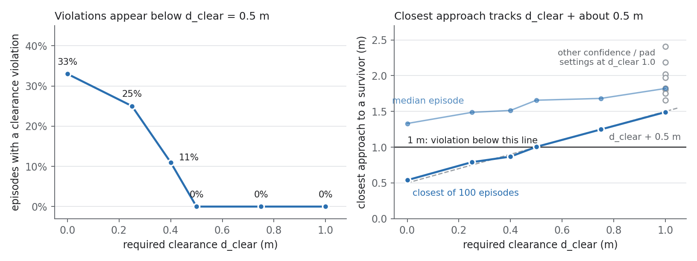

**Figure 20.** Left: fraction of the 100 rubble episodes with a clearance violation against the required clearance `d_clear`, with confidence 0.01 and no pad (so `d_clear` is the only margin left); from Table 22. Right: the closest approach in those episodes (solid: the closest of 100; faded: the median episode) against the 1 m violation line and a `d_clear` + 0.5 m guide. The gray circles at `d_clear` 1.0 are the closest approaches of the other confidence and pad settings in Table 22 (1.66-2.41 m). `scripts/plot_rubble_margins.py`.

**What the sweep shows.** On rubble, the one margin that decides safety is the required clearance itself: the confidence ellipse, the tracking pad and the noise level all had slack, and the closest approach followed `d_clear` + about 0.5 m down to the 1 m line. Nothing in these runs shows the pad or the ellipse doing work; they are not what keeps the robot out of the 1 m zone here.

#### Does the pad bind? Injected tracking error

Every closed-loop rubble run left the pad and the ellipse slack (above), so the claim that the 0.25 m pad is "derived from the measured tracking error" had never been shown to matter. `scripts/pad_binding.py` makes it matter. A closed-loop episode rarely exercises the barrier (the standoff goal sits 0.1 m outside it), so the test is head-on: the nominal controller drives at a survivor and the filter alone stops the robot, so the barrier is active in every run. The plant (`rescue/dist_plant.py`) is the unicycle plus an unmodelled position disturbance (2-D Ornstein-Uhlenbeck velocity, time constant 1 s), which the planner and filter do not know about. Disturbance levels are labelled by the same statistic the pad is derived from, the 95% gap after 1 s against the ideal unicycle (the bare unicycle's own gap is 0.27 m; the Go2 numbers in Table 19 are 0.2-0.95 m). 300 random starts x 2 speeds = 600 runs per cell; violation = robot centre within 1 m of the true survivor. Three cases: `exact` (estimate exact), `ellipse` (estimate error 0.5 m, confidence 0.7, the stack's setting; the true survivor is drawn around the estimate) and `no ellipse` (the same with confidence 0.01).

**Table 23.** Runs (of 600) within 1 m of the survivor, by injected tracking error (95% gap after 1 s) and pad; closest approach in m in brackets.

| Case | 95% gap | Pad 0 | Pad 0.25 m (in use) | Pad 0.5 m | Pad 1.0 m |
| --- | --- | --- | --- | --- | --- |
| exact | 0.27 (none injected) | 0 (1.50) | 0 (1.75) | 0 (2.00) | 0 (2.50) |
| exact | 0.47 | 9 (0.52) | 2 (0.73) | 1 (0.96) | 0 (1.44) |
| exact | 0.88 | 133 | 64 | 37 | 10 |
| exact | 1.30 | 200 | 146 | 101 | 49 |
| ellipse (conf 0.7) | 0.27 | 0 (1.18) | 0 (1.38) | 0 (1.60) | 0 (2.04) |
| ellipse (conf 0.7) | 0.47 | 4 | 2 | 2 | 0 (1.05) |
| ellipse (conf 0.7) | 0.88 | 48 | 33 | 19 | 3 |
| ellipse (conf 0.7) | 1.30 | 109 | 70 | 55 | 20 |
| no ellipse (conf 0.01) | 0.27 | 55 (0.58) | 16 (0.83) | 0 (1.02) | 0 (1.42) |
| no ellipse (conf 0.01) | 0.47 | 108 | 47 | 10 | 2 |
| no ellipse (conf 0.01) | 0.88 | 195 | 124 | 71 | 33 |
| no ellipse (conf 0.01) | 1.30 | 234 | 178 | 134 | 69 |

- **The pad binds.** With the pad at 0 and a 0.47 m tracking error, 9 of 600 runs violate; the violations fall monotonically as the pad grows (9, 2, 1, 0), and the closest approach moves with it. The same holds at larger errors. So the pad does protect against tracking error when the barrier is active; it was slack in the closed-loop runs because those runs never push the robot against the barrier, not because it does nothing.
- **A pad equal to the 95% error does not make it safe.** At a 0.47 m error the 0.5 m pad still has 1 violation; at 0.88 m the pad of 0.5 m leaves 37 of 600 (6%) and even 1.0 m leaves 10. The disturbance here is persistent (1 s correlation), not a one-off 1 s displacement, so the barrier sees it repeatedly; a 95% quantile of a 1 s gap is not a worst-case bound. The wording "the pad is derived from the measured tracking error" is supported only in the sense that the pad is the right size at about the measured error (0.27 m here, 0.25 m pad: no violations); it is not a guarantee, and for a policy with a larger error (the flat-trained one on rubble, 0.59 m) 0.25 m is too small.
- **The ellipse binds too, when the estimate is wrong.** With no tracking error and 0.5 m of estimate error, removing the ellipse (confidence 0.01) at pad 0 gives 55 violations of 600, against 0 at confidence 0.7. Confidence 0.7 also absorbs part of the tracking error (at a 0.88 m error and pad 0.25: 33 against 124). In the closed-loop runs the ellipse was slack because estimates there were good and the fixed margins large; here the pad and ellipse share one job and each covers for the other.
- **What this changes in the writeup.** "The pad is not what is being tested" (Table 21) remains true of the closed-loop runs, but the statement that nothing shows the pad doing work is withdrawn: this test shows it. Not shown: that the pad binds in a closed-loop episode on the real Go2 (the injected error here is a model, not a measured Go2 failure), or that 0.25 m is the right value for the Go2 on rubble (its 95% gap there is 0.36 m).

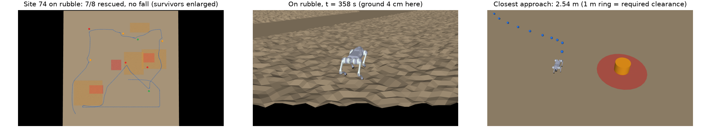

**Figure 19.** Site 74 on the rubble heightfield with the rough policy (7 of 8 rescued, no fall, closest approach 2.54 m). Left: from above, trail at 1 Hz (rubble and hazard regions drawn translucent over the real terrain). Middle: the robot crossing rubble. Right: closest approach with the 1 m ring.

### Answer so far

The Q3 safety result carries over to a legged robot with a learned locomotion policy: the filter kept every episode violation-free on both plants, and the measured tracking error (0.19 m at 95%) is within the pad already in use. The Go2 scores about 0.06 lower than the unicycle, with or without the filter, because it walks slower than commanded. Running on the Go2 also found two stack bugs that could stop the robot for the rest of an episode; both are fixed.

The abrupt case (an estimate appearing 1.5-6 m ahead of a robot at full speed) is covered by the sudden-threat test above: no violation from 2 m on for the stand-alone filter at 1 Hz re-detection (9 of 1,440 runs violate, at a 1.5 m appearance and 1 m/s), but **through the real stack, with the belief's 0.6 s average sense-to-belief latency, 79 of 1,440 filtered runs violate, up to 2.5-3.0 m at full speed (Table 18e)** (and a bad first sighting that is never corrected can be unsafe at any distance, though the stack does not re-detect that slowly). The higher confidence on fresh tracks (`conf_fresh`, off by default) removed 3 of those 9 in the stand-alone test, but once wired into the stack's filter it removes only 2 of 79 violations (Table 18e). The Q3 check now also stands on 100 sites (Table 15 and its replication).

On physical rubble (a heightfield, with a policy retrained on rough terrain) the filter again gave no violations in 100 sites, and the rough-trained Go2 did not fall, while the flat-trained policy fell in 42 of 100 episodes (Tables 19-20); this held at noise of 1.0 and 2.0 m and with a 0.40 m pad (Table 21), though the robot stays about 2.4 m from survivors, so the pad is never close to binding; shrinking the margins (confidence 0.01, no pad) still gave no violations, which only appeared once `d_clear` itself was cut to 0.4 m or less (Table 22); the Go2's score gap to the unicycle is the same on rubble as on flat ground (about 0.065).

**Not yet tested:**
- hazard ground, which the rough policy still crosses poorly.

## Limitations

**Audit of "matches the stack" claims** (after the 10 Hz claim in Experiments 1-3 was found wrong). Checked against the code: (1) the sudden-threat test (`mj_sudden_threat.py`, `mj_sudden_fresh.py`) is a stand-alone filter test with no sighting-to-belief latency, a guaranteed first detection and a first sighting that lands on a plan tick; it is a best case, not the stack (Table 18e: 79 of 1,440 violate through the stack against 9). Its docstring still said "as the stack's belief does" and is fixed. (2) The head-on test (Table 17) makes no update-rate or belief assumption (exact position, filter at every 10 Hz control step, as in the stack), but it is six runs per row and had no violation with the pad off, so it never tested the pad (Table 23 does). (3) Q3 and the rubble tables run the full stack through `run_episode_ctrl`, so their belief rate is the real one; their violations are counted at every 10 Hz step. (4) `conf_fresh` was described as acting in the stack but was not applied by its filter; fixed, effect 79 to 77 violations (Table 18e). (5) Not re-checked: the other uses of "the stack's" in the Q4-Q5 text, which describe the stack's own runs.

**Open issues not yet addressed.** (a) Safety margins cost no score on the rubble benchmark (0.667-0.681 from confidence 0.7 down to 0.01); this shows the cost is nil here, not that it is nil elsewhere, and why the score is so insensitive is not known. (b) The no-filter baseline violates in about 60% of episodes at every noise level, so these runs cannot show the filter protecting more as conditions worsen. (c) The closest approach follows `d_clear` + 0.5 m; the control-point offset (0.25 m) and the overshoot have not been separated, so the guide line in Figure 20 is a fit. (d) A survivor first seen 1.5 m ahead at 1 m/s is inside the barrier when the estimate appears: a design problem (earlier detection, lower speed near unexplored ground), not a margin.

Survivors are a crude stand-in for people: three states, constant-speed motion, a fixed response model, and handling times, decay rates and self-evacuation that are modelling choices. The Q4 triage effect is small (+0.006 +/- 0.004 pooled over 700 sites on the fixed stack, not detectable at 200 sites, and +0.004 +/- 0.004 on the earlier stack) and exists only when the robot is capacity-limited and state sets the handling time; it should not be read as a measured benefit for real triage. Locomotion in the main results is a reduced-order unicycle with a measured tracking-error pad. A full Go2 model with a learned policy has been added in MuJoCo (not Isaac Sim, as proposed) and checked for Q3 only, on 100, 40 and 20 sites, on flat ground with rubble kept as a speed cap, plus a 100-site check on a rubble heightfield with a policy retrained on rough terrain, with zero violations and no falls (see above). Two stack fixes made for it (routing around safety regions, letting confirmed tracks fade) are reflected in Tables 6-11, which were rerun on the fixed stack (the Q4 ablation panels and Table 12 were not). The track-retention gain is shown in the Q1-Q2 simulator only and did not carry over to the closed-loop stack (it is off by default there). Priority ordering was null across a grid of horizons and survivor counts, so its small gain is not explained by T being long. Detections are matched to tracks with a wide gate, so two nearby survivors can share one track and one of them can be lost when the other is rescued. The drone detector is parametric noise, not image-derived. The oracle for Q3-Q4 uses survivors' initial positions. The lower-confidence safety result (zero violations at 0.5-0.7) depends on the 1 m clearance and the fixed margins and was checked at three confidence levels and two noise levels, not at every setting. The Q5 observers are simulated people (the learned one is trained on synthetic walkers), not human subjects.

## Layout

`sim.md` documents the simulators, the policy training and how to reproduce the MuJoCo results.

```
rescue/
  interfaces.py    # Site, Survivor, Detection, Observation, Policy, RunLog, priority classes
  drone_prior.py   # PriorConfig, generate_detections
  belief.py        # Track, Belief (Bayes update from robot observations)
  search.py        # PriorSearch (greedy, optional retention remedies), Coverage (lawnmower), ObservedMap
  baselines.py     # policy factories: coverage, nearest-first, priority
  metrics.py       # rescue score, oracle, time to critical, rescue rate
  terrain.py       # terrain speed + travel-time estimate
  toy_sim.py       # point-robot reference simulator + seeded site generator
  sim.py           # reduced-order Go2 simulator (used for reported results)
  experiments.py   # parallel seeded job runner, CSV, paired statistics
  clearance.py, mpc.py, cbf.py, behavior.py, observer.py   # standalone Q3-Q5 components
  ctrl_sim.py, stack.py, ctrl_mpc.py, safety.py, ctrl_behavior.py, legibility.py,
  approach.py, ctrl_experiments.py                          # closed-loop Q3-Q5
  mj_plant.py      # MuJoCo Go2 + learned locomotion policy (flat or rough-terrain), optional plant for ctrl_sim
  mj_terrain.py    # rubble heightfield from a Site's regions
sim/go2/           # trained policies (policy.onnx flat, policy_rough.onnx rough), their training configs, the Go2 MuJoCo model
sim.md             # simulators, policy training and how to reproduce the MuJoCo results
scripts/smoke_test.py   # compare methods over N sites
scripts/run_sweeps.py   # Q1/Q2 sweeps -> runs/*.csv
scripts/plot_results.py # figures from runs/*.csv
scripts/render_site.py  # site and rollout figures
scripts/render_cases.py # six-panel case-study figure, --stats / --budget
scripts/run_q3.py, run_q4.py, run_q5.py   # standalone component evaluations
scripts/ctrl_run_q3.py, ctrl_run_q4.py, ctrl_run_q5.py   # closed-loop Q3-Q5 runs
scripts/ctrl_run_q4_triage_large.py   # Q4 triage replication on 500 fresh sites
scripts/run_retention.py, run_retention_checks.py, plot_retention.py   # track-retention ablation, fresh-site / region-size / false-positive checks, figure
scripts/ctrl_run_retention.py   # retention in the closed-loop stack
scripts/run_regime.py, run_reward_shape.py, run_reward_weights.py   # Q2 priority vs. nearest-first over horizon / survivor count, reward decay, and class weights
scripts/mj_sudden_threat.py   # sudden close-range threat on both plants
scripts/mj_sudden_fresh.py   # sudden threat with a higher confidence on fresh tracks (single / 10 Hz / 1 Hz re-detection)
scripts/mj_sudden_stack.py   # sudden threat through the real stack (belief at 1 Hz, MPC, filter), with detection latency measured
scripts/pad_binding.py   # head-on test with injected tracking error (rescue/dist_plant.py): does the pad / ellipse bind?
scripts/mj_run_q3_rubble_conf.py, mj_run_q3_rubble_fresh.py   # cost of a higher confidence on rubble: every track vs. fresh tracks only
scripts/profile_layers.py   # per-layer compute timing
scripts/render_rollout.py, render_pipeline.py   # filtered vs. unfiltered rollout figure, pipeline diagram
scripts/ctrl_run_consistency.py   # closed-loop sim vs. the frozen Q1 trends
scripts/ctrl_stats.py, ctrl_plot.py   # paired-difference tables and figures
scripts/mj_calibrate.py, mj_run_q3.py, mj_run_conf.py, mj_cbf_stress.py, render_mj.py   # MuJoCo Go2 checks and figures
scripts/mj_rubble_calibrate.py, mj_run_q3_rubble.py, mj_run_q3_rubble_sweep.py, mj_run_q3_rubble_margins.py, plot_rubble_margins.py, render_mj_rubble.py   # Go2 on a rubble heightfield: tracking and falls, Q3, Q3 at other noise levels and pads, smaller margins, figure
scripts/diag_stall.py   # logs the stack's state in episodes that stall (old stack vs. the fixes)
tests/
docs/INTERFACES.md
```

## Setup

```
pip install -r requirements.txt
python -m pytest
PYTHONPATH=. python scripts/smoke_test.py 20 --sim go2
RESCUE_SIM=go2 PYTHONPATH=. python scripts/run_sweeps.py 40   # -> runs/*.csv
PYTHONPATH=. python scripts/plot_results.py                    # -> runs/figures/
PYTHONPATH=. python scripts/render_cases.py --stats --budget   # -> figures/path_planning/cases_grid.png
# closed-loop Q3-Q5, as reported (last argument: workers; keep ~8 on Windows). Each Q4 triage study is its own sweep.
PYTHONPATH=. python scripts/ctrl_run_q3.py 100 8                # Q3 -> runs/q3_*.csv (incl. confidence sweep)
PYTHONPATH=. python scripts/ctrl_run_q4.py 100 8 default        # Q4 default scene -> runs/q4_*.csv
PYTHONPATH=. python scripts/ctrl_run_q4.py 200 8 triage         # Q4 triage regime -> runs/q4_triage*.csv
PYTHONPATH=. python scripts/ctrl_run_q4_triage_large.py 500 8   # triage replication, 500 fresh sites -> runs/q4_triage_large.csv
PYTHONPATH=. python scripts/ctrl_run_q5.py 100 8                # Q5 (three observers, heading-term sweep) -> runs/q5.csv
PYTHONPATH=. python scripts/ctrl_run_consistency.py 100 8       # vs. frozen Q1; add a 4th argument 5 for a 5 m sensor
PYTHONPATH=. python scripts/ctrl_stats.py                       # paired differences with 95% CIs (markdown)
PYTHONPATH=. python scripts/ctrl_plot.py                        # -> runs/figures/ and markdown tables
```

Requires Python 3.10+, numpy, scipy, matplotlib.

MuJoCo Go2 (optional; needs `pip install "mujoco==3.5.0" onnxruntime`, the MuJoCo version the policy was trained against):

```
PYTHONPATH=. python scripts/mj_calibrate.py      # tracking checks and the tracking-error pad
PYTHONPATH=. python scripts/mj_run_q3.py 40      # Q3 on both plants -> runs/mj_q3.csv
PYTHONPATH=. python scripts/mj_run_conf.py 20    # smaller safety regions, pad on/off -> runs/mj_conf.csv
PYTHONPATH=. python scripts/mj_cbf_stress.py     # head-on stress test of the filter
PYTHONPATH=. python scripts/mj_rubble_calibrate.py --n 200 --policy sim/go2/policy_rough.onnx   # tracking and falls on rubble
PYTHONPATH=. python scripts/mj_run_q3_rubble.py 100 16   # Q3 on rubble -> runs/mj_q3_rubble.csv
PYTHONPATH=. python scripts/mj_run_q3_rubble_sweep.py 100 16   # rubble at sigma_meas 1.0 / 2.0 m and pad 0.40 m -> runs/mj_q3_rubble_sweep.csv
PYTHONPATH=. python scripts/mj_run_q3_rubble_margins.py 100 16        # smaller margins on rubble -> runs/mj_q3_rubble_margins.csv
PYTHONPATH=. python scripts/mj_run_q3_rubble_margins.py 100 16 low    # d_clear 0.4 / 0.25 / 0 -> runs/mj_q3_rubble_margins_low.csv
PYTHONPATH=. python scripts/plot_rubble_margins.py                # Figure 20 -> figures/mujoco/rubble_margins.png
PYTHONPATH=. python scripts/mj_sudden_fresh.py 30 16                # fresh-track confidence in the sudden-threat test -> runs/mj_sudden_fresh.csv
PYTHONPATH=. python scripts/mj_run_q3_rubble_conf.py 100 16            # 0.9 / 0.95 / 0.99 on every track -> runs/mj_q3_rubble_conf.csv
PYTHONPATH=. python scripts/mj_run_q3_rubble_fresh.py 100 16           # fresh tracks only -> runs/mj_q3_rubble_fresh.csv
PYTHONPATH=. python scripts/render_mj_rubble.py 74       # figures/mujoco/go2_rubble_site_074.png (MUJOCO_GL=egl if headless)
PYTHONPATH=. python scripts/render_mj.py         # -> figures/mujoco/ (five 600 s Go2 episodes in parallel)
PYTHONPATH=. python scripts/diag_stall.py        # stack-state log of the sites that stalled before the fixes
```

Retraining the policy (Linux or WSL2, NVIDIA GPU; full commands, versions and the rough-terrain run, which needs 2048 environments on a 12 GB GPU, are in [`sim.md`](sim.md)): clone `unitree_rl_mjlab`, `pip install -e .` in a Python 3.11 environment, pin `mujoco==3.5.0` and `warp-lang==1.12.0` (the versions pip picks by default break mjlab 1.2.0), `pip install scipy`, then `python scripts/train.py Unitree-Go2-Flat --env.scene.num-envs=4096 --agent.logger tensorboard --agent.max-iterations 3000`. The exported `policy.onnx` lands in `logs/rsl_rl/go2_velocity/<run>/`.

## Future work

Open problems found by the experiments above, in the order planned. The first is done as an option (below); the second has not been started.

1. **Fix the sudden-threat weak spot. Open, and larger than first measured.** Through the real stack (belief at 1 Hz, MPC, filter) 79 of 1,440 first-sighting runs violate, up to 2.5-3.0 m at full speed (Table 18e), not 9 as the stand-alone test said, because a sighting takes 0.6 s on average to reach the belief. The `conf_fresh` option is now wired into the stack's filter but removes only 2 of the 79 violations (77 with it); its earlier effect was measured on the stand-alone filter. A survivor first seen 1.5 m ahead at 1 m/s is already inside the barrier when the estimate appears; fixing the cases needs earlier detection (use the detection directly in the 10 Hz filter instead of waiting for the next plan tick), a lower speed near unexplored ground, or both; a bigger region cannot help.
2. **Find out why track retention did not transfer to the closed-loop stack.** Retention helps in the search simulator ([Track retention](#track-retention-fixing-the-dropped-track-loss)) but not in the closed-loop Go2 stack. Log where the robot parks and which tracks it holds in the closed-loop runs, compare with the search simulator on the same sites, and see whether the cause is the standoff behavior, the safety regions or the belief's forgetting of stale tracks.
