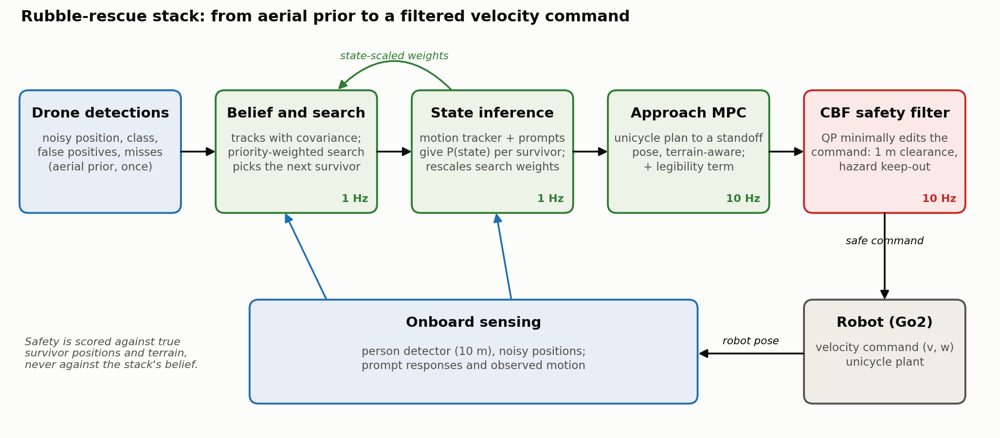
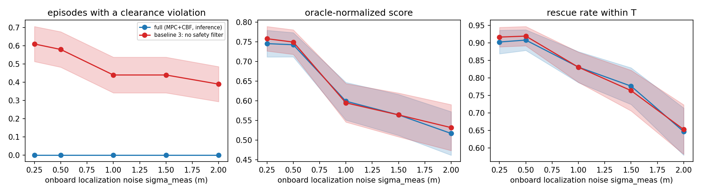

# Rubble Rescue Quadruped

A simulation study of how a four-legged robot (a Unitree Go2) can search a collapsed building for survivors, using a drone's rough survey as a head start, while never getting dangerously close to a person it has not yet located precisely.

Everything here is simulation. There is no hardware, and the "survivors" are simple scripted agents, not people.

## The problem in one paragraph

After a collapse, a drone flies over the site once and reports a list of *likely* survivor locations. The list is imperfect: positions are off by a few metres, some survivors are missed, some detections are false alarms, and each survivor's urgency label (critical / urgent / stable) can be wrong. A ground robot then has to decide **whom to visit first**, **how to walk up to them without bumping into or frightening them** (rubble and hazard zones included), and **what condition they are in** (unresponsive, trapped, or able to move) when they cannot tell it. The robot is scored on how much *urgency-weighted* rescue it achieves in a time limit.

## Glossary

| Term | Meaning |
| --- | --- |
| Site | One randomly generated collapse scene: a rectangular area with rubble (slow to cross), hazard zones (avoid), 3-8 survivors and a robot start point. A seed reproduces it exactly. |
| Aerial prior | The drone's one-time list of detections: noisy positions, possible misses and false alarms, and a possibly wrong class label. |
| Triage class | Urgency of a survivor: *critical*, *urgent* or *stable*. Weights 4 / 2 / 1; critical survivors also "decay" (lose value) fastest. These are modelling choices, not medical facts. |
| Survivor state | What the survivor is doing: *unresponsive*, *trapped*, or *mobile*. Hidden from the robot; it must infer it from how they move and respond to prompts. |
| Belief / track | The robot's probabilistic estimate of where each survivor is (a "track" is one candidate survivor with a position, uncertainty and a probability that it really exists). |
| Rescued / reached | A survivor counts as rescued when the robot gets within a set distance (the *rescue radius*) of them. |
| Score (oracle-normalized) | Urgency-weighted, time-discounted rescues, divided by what a perfect-knowledge planner would get on the same site. 1.0 is perfect; 0.0 is nothing. |
| Rescue rate | Fraction of survivors reached within the time limit T (600 s unless stated). |
| Time to critical | Average time at which critical survivors are reached (T is counted for any not reached). |
| Sigma (position noise) | Standard deviation, in metres, of the drone's position error. Larger means a worse prior. |
| Clearance / violation | Robots must stay at least 1 m from every survivor. A *clearance violation* is the robot centre coming within 1 m of one (judged against true positions, not the robot's belief). |
| MPC | Model-predictive control: the planner that picks short-horizon motions toward a goal. |
| CBF safety filter | Control-barrier-function filter: a small optimisation that minimally edits the planner's velocity command so the robot stays outside keep-out regions. |
| Legibility | How easily an observer can tell where the robot is heading from its motion alone. |
| Unicycle plant | The simplified robot model (forward speed + turn rate) used for most results. |
| MuJoCo Go2 | A full physical Go2 model walking with a learned locomotion policy, used for the later checks. |
| Paired difference | A comparison on the same sites and detections, so site-to-site luck cancels. Reported as mean +/- 95% confidence half-width; "detectable" means the interval excludes zero. |

## How the system works



Three layers run at different rates:

1. **Search (1 Hz).** Keeps a belief over where survivors are, seeded by the drone prior and updated by what the robot's onboard sensor sees. Each step it picks the survivor with the best `reward x urgency weight x exp(-decay x arrival time) / travel time`, so close, urgent survivors come first.
2. **Approach planner (10 Hz).** An MPC drives the robot to a *standoff* point just short of the survivor, slows on rubble, and can add a legibility term.
3. **Safety filter (every control step).** A CBF filter vetoes any command that would put the robot inside a hazard region or within the clearance of a survivor, using a confidence ellipse around the belief so uncertainty makes the keep-out larger.

A fourth component infers each survivor's state from their motion and responses to prompts, and feeds it back into the search weights.

Goal: maximise `E[ sum_i w_i * exp(-lambda_i * t_i) * 1[t_i <= T] ]` (urgency-weighted rescue value, discounted by the time `t_i` at which survivor `i` is reached), subject to the safety constraint.

## Research questions and short answers

All numbers are means over 40-200 simulated sites; full tables, confidence intervals and caveats are in [`docs/RESULTS.md`](docs/RESULTS.md).

| # | Question | Short answer |
| --- | --- | --- |
| Q1 | How much does the drone prior help vs. searching with no prior, and when does it stop helping? | A lot when accurate: score 0.73 vs 0.23 (about 3x) at sigma 3 m. The benefit disappears around sigma 15 m and reverses at 25 m. False alarms matter much less than position error. |
| Q2 | Does searching by urgency reach critical survivors sooner than just going to the nearest one? | Only slightly, and only when class labels are nearly always right (about +0.03 score at 100% label accuracy, nothing detectable at 80%). With the default reward the time decay cancels the class weights. If class weights were much larger than the decay, the gain reaches +0.05 to +0.10. |
| Q3 | Can a safety filter that uses the belief's uncertainty eliminate clearance violations, and what does it cost as localization noise grows? | Yes. Zero violations in thousands of filtered episodes, versus 44-61% of episodes with a violation without the filter. At the default setting the score cost is within noise. This also held on a full Go2 model, including on physical rubble. One weak spot remains: a survivor first sensed less than about 3 m away at full speed. |
| Q4 | How fast and accurately can survivor state be inferred, and does it help? | State is inferred 87% correctly on average, about 3 s after first sighting. It does not change the score in the default scene, and helps only a little (about +0.006) when the robot is overloaded and state sets handling time. |
| Q5 | Does a legibility term let an observer identify the robot's goal sooner, and at what cost? | Yes, for three different simulated observers. A heading-based term costs about +5% approach time; the heavier cost-model term costs about +33%. |

Baselines used: (1) coverage search with no prior, (2) prior with nearest-first ordering, (3) no safety filter, (4) no state inference, (5) an oracle that learns state by communication.

### Headline figures


*Score, time to critical and rescue rate as drone position noise grows. The dashed grey line is the no-prior baseline.*



*Clearance violations, score and rescue rate vs. onboard localization noise, with and without the safety filter.*


*Six single-site rollouts showing how survivors get lost: drone misses, a position that is too far off, and false alarms.*

## Important caveats

- **Simulation only.** Survivors are scripted agents with three states and a fixed response model. Decay rates, handling times and class weights are assumptions, not calibrated to real triage.
- **Two simulators.** Q1-Q2 use a faster waypoint-level simulator with a 5 m sensor. Q3-Q5 use a 10 Hz control-rate simulator with a 10 m sensor, so absolute scores are not comparable between them (trends are; see the consistency check in the results doc).
- **Reduced-order robot for most results.** The full MuJoCo Go2 with a learned walking policy was checked for Q3 only, on 20-100 sites.
- **Detector is parametric noise,** not derived from images.
- Many comparisons are uncorrected for multiple testing; read patterns, not single cells.

The complete list of limitations and open issues is at the end of [`docs/RESULTS.md`](docs/RESULTS.md).

## Repository layout

```
rescue/            # the library
  interfaces.py    #   core data types (Site, Survivor, Detection, ...)
  drone_prior.py   #   simulated drone survey (noise, misses, false alarms)
  belief.py        #   survivor tracks and Bayes updates
  search.py        #   priority-weighted search layer and baselines
  metrics.py       #   score, oracle, time to critical, rescue rate
  toy_sim.py, sim.py            # point-robot and reduced-order Go2 simulators (Q1-Q2)
  ctrl_sim.py, stack.py, ...    # 10 Hz closed-loop simulator and full stack (Q3-Q5)
  mj_plant.py, mj_terrain.py    # optional MuJoCo Go2 + learned policy, rubble terrain
sim/go2/           # trained locomotion policies and Go2 model
scripts/
  experiments/     #   run sweeps (Q1-Q5)
  mujoco/          #   Go2 checks (Q3, stress tests, rubble)
  figures/         #   regenerate every figure in figures/
  diagnostics/     #   profiling and debugging tools
tests/             # pytest suite
docs/
  RESULTS.md       #   full results, tables, design log, limitations, future work
  sim.md           #   simulators, policy training, MuJoCo reproduction
  INTERFACES.md    #   module contracts
figures/           # committed figures
```

## Setup and quick start

Requires Python 3.10+.

```powershell
pip install -r requirements.txt
python -m pytest
```

A quick check that the simulator runs (20 sites):

```powershell
$env:PYTHONPATH="."; python scripts/experiments/smoke_test.py 20 --sim go2
```

Reproduce Q1-Q2 (40 sites per setting) and the plots:

```powershell
$env:RESCUE_SIM="go2"; $env:PYTHONPATH="."; python scripts/experiments/run_sweeps.py 40
$env:PYTHONPATH="."; python scripts/figures/plot_results.py
```

Reproduce closed-loop Q3-Q5 (last argument is the worker count; use 3-4 to keep your machine responsive):

```powershell
$env:PYTHONPATH="."; python scripts/experiments/ctrl_run_q3.py 100 4
$env:PYTHONPATH="."; python scripts/experiments/ctrl_run_q4.py 100 4 default
$env:PYTHONPATH="."; python scripts/experiments/ctrl_run_q5.py 100 4
$env:PYTHONPATH="."; python scripts/experiments/ctrl_stats.py
```

Raw per-site results are git-ignored, so rerun a script to regenerate them. The remaining commands (Q4 triage, consistency check, every MuJoCo experiment) are listed in the [reproduction section of `docs/RESULTS.md`](docs/RESULTS.md#setup) and in [`docs/sim.md`](docs/sim.md).

### Optional: MuJoCo Go2

```powershell
pip install "mujoco==3.5.0" onnxruntime
$env:PYTHONPATH="."; python scripts/mujoco/mj_run_q3.py 40
```

Retraining the locomotion policy needs Linux or WSL2 with an NVIDIA GPU; see [`docs/sim.md`](docs/sim.md).

## Where to read next

- Full results, tables and figures: [`docs/RESULTS.md`](docs/RESULTS.md)
- How the simulators fit together and how to reproduce the MuJoCo work: [`docs/sim.md`](docs/sim.md)
- Module interfaces: [`docs/INTERFACES.md`](docs/INTERFACES.md)
