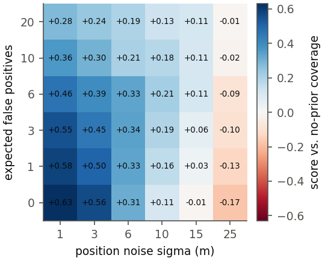

# Rubble Rescue Quadruped

Drone-informed, priority-aware search and rescue with a quadruped robot. Course project for Human-Centered Robotics (Valerie Liang, Sahil Patel).

After a collapse, a simulated quadrotor surveys the site and hands a Unitree Go2 a list of likely survivor locations, each with position uncertainty and a triage priority (critical, urgent, stable). The quadruped must decide whom to reach first, how to approach safely, and (later) how to infer each survivor's state when they cannot answer.

## Approach

Three layers approximate the underlying POMDP:

1. **Search layer (~1 Hz):** greedy, priority-weighted, urgency-discounted search over a belief seeded by the aerial prior. Score per track is `r * w * exp(-lambda * t_arrive) / (tau + 1)^k`; `k = 1` (reward per second of travel) was best in a 60-site check (k = 0.5, 0.25, 0 were worse on score and time to critical), so it is the default (`dist_exp`).
2. **Approach planner (~10 Hz):** MPC with a unicycle model and a standoff pose as goal, plus a legibility term.
3. **Safety filter (every control step):** CBF-QP enforcing clearance from survivors and hazardous terrain.

Objective: maximize `E[ sum_i w_i * exp(-lambda_i * tau_i) * 1[tau_i <= T] ]` subject to a safety constraint, where `tau_i` is the time survivor `i` is reached.

## Research questions

|    | Question                                                                                                                                      |
| -- | --------------------------------------------------------------------------------------------------------------------------------------------- |
| Q1 | How much does the aerial prior help vs. prior-free coverage, and when does it stop helping?                                                   |
| Q2 | Does priority-weighted search reach critical survivors sooner than nearest-first?                                                             |
| Q3 | Can a CBF filter using a high-probability region of the belief eliminate violations, and what does it cost as localization uncertainty grows? |
| Q4 | How fast and accurately can survivor state (unresponsive / trapped / mobile) be inferred?                                                     |
| Q5 | Does a legibility term let an observer identify the goal earlier, and at what cost?                                                           |

Baselines: (1) coverage with no prior, (2) prior with nearest-first, (3) no safety filter, (4) no state inference, (5) communication oracle.

Metrics: priority-weighted rescue score (oracle-normalized), time to critical survivors, rescue rate within `T`, state-inference accuracy, safety violations.

## Status

Implemented (Q1-Q2):

- Drone prior: position noise, misses, false positives, class errors
- Belief with Bayes update
- Greedy search layer (priority-weighted, urgency-discounted) and baselines 1-2
- Metrics: weighted rescue score, oracle normalization, time to critical, rescue rate
- Simulators: point-robot reference (`toy_sim.py`) and reduced-order Go2 (`sim.py`), with a parallel batch runner
- Q1 sweep (prior noise, false-positive rate), Q2 comparison with a class-accuracy sweep, and plots

Not yet implemented: MPC approach planner, CBF safety filter, state inference, legibility (Q3-Q5).

## Results

Go2 sim, T = 600 s, 40 sites per config (160 for Q2). Default prior: sigma 3 m, 1 false positive, 10% miss, 80% class accuracy. Each sweep varies one setting and holds the rest at default. Figures are committed in [`figures/metrics/`](figures/metrics/). The raw per-site results (`runs/*.csv`) are git-ignored; regenerate them, and fresh figures in `runs/figures/`, with the commands under Setup.

**Metrics.** *Score* is the priority-weighted rescue score divided by the oracle's, so 1.0 is perfect. The oracle is a terrain-aware upper bound (shortest paths over rubble and hazards, standoff radius at each survivor, no robot dynamics), so scores never exceed 1 (observed maximum 0.993). *Rescue rate* is the fraction of survivors reached within T. *Time to critical* is, per site, the mean over its critical survivors of the time each is reached, counting T (600 s) for any not reached; sites with no critical survivor are excluded.

### Q1: how much does the aerial prior help?

The coverage baseline uses no prior, so it is the same in every column. It scores 0.228, reaches 42% of survivors and averages about 430 s to reach its critical survivors.

**Table 1.** Value of the aerial prior vs. position noise.

| sigma                                  | 1    | 3    | 6    | 10   | 15   | 25   |
| -------------------------------------- | ---- | ---- | ---- | ---- | ---- | ---- |
| Score, prior + priority                | 0.81 | 0.73 | 0.56 | 0.39 | 0.26 | 0.10 |
| Score, coverage                        | 0.23 | 0.23 | 0.23 | 0.23 | 0.23 | 0.23 |
| Rescue rate, prior + priority          | 0.94 | 0.85 | 0.69 | 0.56 | 0.45 | 0.22 |
| Time to critical (s), prior + priority | 157  | 175  | 212  | 318  | 432  | 533  |

*Caption: sigma is the standard deviation (m) of the Gaussian noise added to each axis of the drone's survivor position estimates; larger sigma means a less accurate prior. Score is oracle-normalized (1.0 is perfect). Each column is the mean over 40 sites, all other prior settings at default. Coverage uses no prior, so it does not depend on sigma.*


**Figure 1.** Score, time to critical and rescue rate vs. position noise sigma (log axis). Lines are means over 40 sites; bands are 95% confidence intervals. The grey dashed line and band are the no-prior coverage baseline. Priority-weighted and nearest-first overlap almost exactly, since the prior, not the ordering, drives the gap to coverage.

**Table 2.** Value of the aerial prior vs. false-positive rate.

| false positives                        | 0    | 1    | 3    | 6    | 10   | 20   |
| -------------------------------------- | ---- | ---- | ---- | ---- | ---- | ---- |
| Score, prior + priority                | 0.79 | 0.73 | 0.68 | 0.62 | 0.53 | 0.46 |
| Score, coverage                        | 0.23 | 0.23 | 0.23 | 0.23 | 0.23 | 0.23 |
| Rescue rate, prior + priority          | 0.90 | 0.85 | 0.84 | 0.78 | 0.71 | 0.65 |
| Time to critical (s), prior + priority | 143  | 175  | 215  | 208  | 266  | 344  |

*Caption: false positives is the mean of a Poisson count of spurious detections added per site, so the robot may be sent to survivors that do not exist. Mean over 40 sites per column, all other prior settings at default (sigma 3 m).*


**Figure 2.** Same three metrics vs. expected false positives per site, with the same lines, bands and baseline as Figure 1.



**Figure 3.** Prior + priority score minus no-prior coverage score over the full grid of position noise and false positives (40 sites per cell). Blue means the prior helps and red means it is worse than no prior; white is break-even. Break-even is at sigma of roughly 15-25 m and shifts toward larger sigma as false positives increase; at low noise, extra false positives cost the prior up to about 0.35 of score.

**Answer.** The prior helps a lot when it is accurate: at sigma = 3 m the score is 0.73 against 0.23 for coverage, about 3x. The gain shrinks steadily as noise grows. At sigma = 15 m the prior only matches coverage (0.26 vs 0.23, and time to critical is no better), and at 25 m it is worse than having no prior (0.10). False positives hurt much less. Even 20 spurious detections per site leave the score at 0.46, twice coverage. Position noise is what limits the prior, not clutter.

### Q2: does priority-weighted search reach critical survivors sooner than nearest-first?

Both methods use the same prior; they differ only in whether the triage class sets the target's weight. Differences are priority minus nearest, paired by site, shown as mean +/- 95% CI half-width.

**Table 3.** Priority-weighted vs. nearest-first search at the default config.

| Metric               | Nearest-first | Priority | Difference                                         |
| -------------------- | ------------- | -------- | -------------------------------------------------- |
| Score                | 0.720         | 0.733    | +0.013 +/- 0.014                                   |
| Rescue rate          | 0.854         | 0.859    | +0.005 +/- 0.009                                   |
| Time to critical (s) | 198           | 188      | -9.6 +/- 15.2 (123 sites have a critical survivor) |

*Caption: means over 160 sites. Difference is priority minus nearest-first, paired by site, with a 95% confidence half-width. For time to critical a negative difference means priority is faster, and only the 123 sites that contain a critical survivor count. No difference is significant here, because every interval includes zero.*

**Table 4.** Priority-weighted vs. nearest-first search as the drone's triage-class accuracy varies.

| Class accuracy       | 40%              | 60%              | 80% (default)    | 90%              | 100%             |
| -------------------- | ---------------- | ---------------- | ---------------- | ---------------- | ---------------- |
| Score, nearest-first | 0.709            | 0.729            | 0.720            | 0.722            | 0.713            |
| Score, priority      | 0.707            | 0.733            | 0.733            | 0.740            | 0.740            |
| Score difference     | -0.003 +/- 0.016 | +0.004 +/- 0.015 | +0.013 +/- 0.014 | +0.018 +/- 0.014 | +0.026 +/- 0.015 |

*Caption: class accuracy is the probability that the drone labels a survivor with its correct triage class (critical, urgent, stable); otherwise the label is wrong. 160 paired sites per column, all other prior settings at default. Differences are priority minus nearest-first, mean +/- 95% half-width, and are not corrected for the five comparisons. At 100% accuracy, time to critical is also 17.6 +/- 14.1 s faster with priority weighting.*


**Figure 4.** Paired priority-minus-nearest-first difference vs. drone class accuracy for score (higher is better), time to critical (lower is better) and rescue rate. Points are means over 160 sites and bars are 95% confidence intervals; an interval that excludes the zero line is a detectable difference.

**Answer.** Only partly, and only when the classes are reliable. Priority weighting does nothing at 40-80% class accuracy. Only the 90% and 100% points exclude zero, and those intervals are not corrected for the five comparisons. Even at 100% the gain is about 3 points of normalized score, so the effect is small. Most of the benefit of the pipeline comes from the prior (Q1), not from priority ordering.

The Go2 and toy simulators give near-identical numbers. Hazards are slow but traversable, and robot pose is true pose.

## Layout

```
rescue/
  interfaces.py    # Site, Survivor, Detection, Observation, Policy, RunLog, priority classes
  drone_prior.py   # PriorConfig, generate_detections
  belief.py        # Track, Belief (Bayes update from robot observations)
  search.py        # PriorSearch (greedy), Coverage (lawnmower)
  baselines.py     # policy factories: coverage, nearest-first, priority
  metrics.py       # rescue score, oracle, time to critical, rescue rate
  terrain.py       # terrain speed + travel-time estimate
  toy_sim.py       # point-robot reference simulator + seeded site generator
  sim.py           # reduced-order Go2 simulator (used for reported results)
  experiments.py   # parallel seeded job runner, CSV, paired statistics
scripts/smoke_test.py   # compare methods over N sites
scripts/run_sweeps.py   # Q1/Q2 sweeps -> runs/*.csv
scripts/plot_results.py # figures from runs/*.csv
scripts/render_site.py  # site and rollout figures
tests/
docs/INTERFACES.md
```

## Setup

```
pip install -r requirements.txt
python -m pytest
PYTHONPATH=. python scripts/smoke_test.py 20 --sim go2
RESCUE_SIM=go2 PYTHONPATH=. python scripts/run_sweeps.py 40   # -> runs/*.csv
PYTHONPATH=. python scripts/plot_results.py                    # -> runs/figures/
```

Requires Python 3.10+, numpy, scipy, matplotlib.
